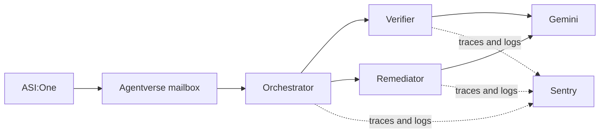

# AdProof

## 1. What AdProof does

AdProof is a bounded, evidence-backed advertising preflight prototype. It extracts objective claims from one ad image and its copy, compares them with a supplied product page and bounded evidence, and identifies unsupported or contradictory claims. It may propose at most one minimal copy-only repair and independently audit the revision against the unchanged image. It never edits images or publishes ads.



See the [architecture overview](docs/architecture.md) for component details.

## 2. Prerequisites

- Python 3.11, [uv](https://docs.astral.sh/uv/), and Git.
- Install uv with the official installer:

  ```sh
  curl -LsSf https://astral.sh/uv/install.sh | sh
  ```

- A Gemini API key with billing enabled for live runs. The free tier has run out after about 6–8 calls in validation; one `demo aerobeat` workflow uses about 8 calls. Quotas and provider behavior can change.
- Optional Sentry DSN for tracing and logs.
- An Agentverse account and an ASI:One account, both available through [asi1.ai](https://asi1.ai). The Agentverse inspector is also available at [agentverse.ai](https://agentverse.ai).

## 3. Install and offline check

```sh
git clone https://github.com/Rathish-Rajendran/AdProof.git
cd AdProof
uv sync --frozen
uv run pytest -q
uv run ruff check .
uv run python -m adproof.demo --mode mock
```

The explicit `--mode mock` demonstration is deterministic and offline. It does not call Gemini or establish live-model performance.

## 4. Configure

If you do not already have a private environment file, create it from the example and edit it locally:

```sh
if [ ! -f .env ]; then cp .env.example .env; fi
$EDITOR .env
```

Set `GEMINI_API_KEY` to your key, keep `GEMINI_MODEL=gemini-3.5-flash`, and set `ADPROOF_MAILBOX_ENABLED=1` for Agentverse/ASI:One. Optionally set `SENTRY_DSN`, `SENTRY_ENVIRONMENT`, and `SENTRY_TRACES_SAMPLE_RATE=1.0`. Do not paste keys or seed values into source files, logs, issues, or commits.

The local Python settings and `scripts/run_all.sh` do **not** load `.env` automatically. Export its values in each shell before starting local commands, and keep that shell open:

```sh
set -a
source .env
set +a
```

On first start, the runtime generates private identities in `runtime/agent-seeds.json` and writes their public addresses to `runtime/agents.json`. The seed file is gitignored and mode `0600`; back it up securely to preserve the agent addresses and mailbox identity. You may supply `ORCHESTRATOR_SEED`, `VERIFIER_SEED`, and `REMEDIATOR_SEED` in `.env` instead. Never publish those values.

## 5. Optional live Gemini smoke

With the environment loaded as above, run a small paid live evaluation:

```sh
uv run python -m adproof.eval --live --cases 1,2 --max-model-calls 12
```

This makes real model calls and writes a JSON report under `runtime/eval/`. Case 1 is expected to find unsafe claims and decide `FIX_REQUIRED`; case 2 is expected to pass. Provider errors or quota exhaustion can instead produce `HUMAN_REVIEW`. Do not run this if you need to conserve API quota.

## 6. Start the three agents

In the same shell where `.env` is exported:

```sh
bash scripts/run_all.sh
```

The script prepares the runtime, starts the orchestrator, verifier, and remediator, and stays in the foreground. It prints `All local agents are healthy. Press Ctrl-C to stop them.` after the `/health` checks pass. Logs are `runtime/orchestrator.log`, `runtime/verifier.log`, and `runtime/remediator.log`; the orchestrator log contains the Agent inspector URL.

In a second terminal, load the environment there too, then check health and public addresses:

```sh
# Run these from the repository root.
set -a
source .env
set +a
uv run python -m adproof.status
```

Healthy output lists `HEALTHY` for all three roles. Stop the foreground supervisor with Ctrl-C; it stops the child agents.

## 7. Connect the orchestrator to Agentverse (mailbox)

1. Find the inspector URL in `runtime/orchestrator.log` (for example, search for `Agent inspector available at`) and copy it without exposing secrets.
2. Open that URL in a browser **on the same machine running the agent**. The inspector connects to `http://127.0.0.1:8100`; a browser on another computer checks that computer's loopback and will not find this agent.
3. Sign in to Agentverse (bottom-left), select **Connect → Mailbox**, and accept the **Check your agent** dialog. Start the orchestrator with `ADPROOF_MAILBOX_ENABLED=1` first; `mailbox=True` is already configured, so this Connect step requires no code change or restart.
4. Success indicators: `runtime/orchestrator.log` shows `[mailbox]: Successfully registered as mailbox agent in Agentverse`, the inspector shows **Modify connection / Agent Profile**, and the orchestrator appears under **Agentverse → My Agents**.
5. Optionally confirm the public Almanac API record:

   ```sh
   ORCHESTRATOR_ADDRESS="$(uv run python -c 'import json; print(json.load(open("runtime/agents.json"))["orchestrator"])')"
   curl -fsS "https://agentverse.ai/v1/almanac/agents/${ORCHESTRATOR_ADDRESS}"
   ```

   A connected mailbox reports `status: active` and `type: mailbox`.
6. The “not enough funds to register on Almanac contract” warning is harmless. Successful Almanac API mailbox registration is sufficient; on-chain contract registration is optional and requires no funds for this workflow.
7. Optionally set `ADPROOF_ORCHESTRATOR_HANDLE` to a unique Agentverse handle. Re-run the inspector's **Modify connection / Connect** flow after setting or changing it. ASI:One `@handle` support is unverified; use the full agent address.

## 8. Test in ASI:One

1. At [asi1.ai](https://asi1.ai), start a chat and put `adproof-orchestrator` in the **To:** box, or prefix each message with `@<orchestrator address>`. Without the `@` mention or recipient, the message goes to ASI:One's own AI.
2. Send `help`, then `demo aerobeat`.
3. The expected case-1 result is an original `FIX_REQUIRED` audit with four issues: two `AD_LANDING_PAGE_CONTRADICTION` findings for waterproof and 48-hour battery claims, `UNVERIFIED_ENDORSEMENT` for the unsupported athlete endorsement, and `PRICE_DISCOUNT_MISMATCH` for the 50%-off claim (the evidence establishes 25%). The workflow proposes one copy-only repair and independently re-checks it against the same image. The latest live repair proposal was “AeroBeat headphones are splash-resistant for everyday use. Get up to 30 hours of battery life with noise cancellation off. Now $60—25% off!” The result card includes **Show report** and **Status**; **Run one repair** is available only when the original is `FIX_REQUIRED` and no repair exists yet.
4. Try `demo aerobeat49` to see that a copy edit cannot change the `$49` shown in the image, so the image issue remains `FIX_REQUIRED`; `demo aerobeat correct` audits the already-correct ad.
5. `HUMAN_REVIEW` with `MODEL_UNAVAILABLE` generally indicates quota exhaustion (often HTTP 429) or provider unavailability (often HTTP 503). `MODEL_AUTH` (HTTP 401) indicates a bad or stale key: update `.env`, re-export it, and restart the agents so they use the new value.

## 9. Always-on hosting (Docker)

Use the private `.env` from section 4; if starting from a fresh checkout, create it from the example. Set `ADPROOF_MAILBOX_ENABLED=1` and add the private model key if using LIVE:

```sh
if [ ! -f .env ]; then cp .env.example .env; fi
$EDITOR .env
docker compose config --quiet
docker compose up --build -d
docker compose ps
docker compose logs orchestrator
```

Compose loads `.env` itself. The Compose named `runtime` volume holds the container identities across restarts. To retain the address already connected in Agentverse, privately copy the values from your existing `runtime/agent-seeds.json` into `ORCHESTRATOR_SEED`, `VERIFIER_SEED`, and `REMEDIATOR_SEED` in `.env`; never print or commit them. Connect the mailbox using a browser on the Docker host, where port 8100 is published.

**Docker validation:** Docker is available in the validation environment, and `docker compose config --quiet` passed using a temporary `.env` copied from `.env.example`. The full `docker compose up` was **not** tested in this validation.

## 10. Troubleshooting

| Symptom | Cause | Fix |
|---|---|---|
| “Agent mailbox not found” | The orchestrator mailbox has not been connected yet. | Follow [step 7](#7-connect-the-orchestrator-to-agentverse-mailbox). |
| Inspector **Connect** is greyed out | Not signed in, or the inspector was opened in a browser on another machine. | Sign in and open the inspector on the machine running the agent. |
| Agentverse **My Agents** is empty | The inspector Connect flow was not completed. | Complete [step 7](#7-connect-the-orchestrator-to-agentverse-mailbox). |
| ASI:One does not reply | Agents are stopped, the host is asleep, or the message was not addressed to the agent. | Check `runtime/orchestrator.log`, verify the recipient/`@` mention, and restart the agents if needed. |
| `Request could not be processed (ValueError)` | An old build does not strip ASI:One's leading `@` mention. | Pull/update the current code and restart the orchestrator. |
| `MODEL_AUTH` HTTP 401 | The configured key is invalid or stale. | Update `.env`, re-export it, and restart/recreate the agents. |
| `MODEL_UNAVAILABLE` / quota | The Gemini free-tier quota is exhausted; HTTP 503 may also indicate provider unavailability. | Enable billing for quota exhaustion; retry later for a provider 503. |
| “Not enough funds to register on Almanac contract” | Optional on-chain registration was skipped. | No action needed; successful Almanac API mailbox registration is sufficient. |

## 11. Validation status

See the detailed [validation status](docs/validation-status.md). Live Agentverse mailbox registration, Sentry ingestion, and the ASI:One help round-trip have passed. In the latest user-reported ASI:One case-1 run, the original four-issue `FIX_REQUIRED` audit and the copy-only repair proposal succeeded through all three agents; Gemini quota exhaustion blocked only the final re-verification, leaving the workflow `PARTIAL` with `HUMAN_REVIEW` and `repair_verified=false`.

## 12. Agent addresses

These current public addresses are derived from the private seeds in `runtime/agent-seeds.json` and listed in `runtime/agents.json`. They change if the seeds are rotated.

| Agent | Current public address |
|---|---|
| Orchestrator | `agent1q0lpgrz6c80h2n5ns0vw5sq0wtrp8gkm92x3pl6n5hwru7z0f47977ntemy` |
| Verifier | `agent1qv78z88d9lj2cmgf5yjg853ulc0sw8v4qmscar56wr8rqsn97xk9c08deh8` |
| Remediator | `agent1qfc0a6u3lq3azyj93ptz3lkx6rkvhgggg5n7knx6g45fncl4f5qqqfwenq8` |

## Scope and limitations

**Scope:** Google Ads, United States, English, adult-targeted general consumer electronics. A PASS means only that the checks and sources named in that report completed; it is not legal advice, legal review, platform certification, approval, or a safety guarantee. The service does not publish ads.

One campaign supports one PNG/JPEG image, one copy string, one HTTPS landing page, and up to three supplied text/HTML evidence documents. Authenticated pages, PDFs, arbitrary browsing, other locales/platforms/categories, and campaign publishing are out of scope. Unavailable evidence, unsupported context, and materially unreadable image text require review. See [policy scope](docs/policy-scope.md), [architecture](docs/architecture.md), [evaluation](docs/evaluation.md), [setup](docs/setup.md), and the [build brief](docs/build-brief/DEVIN_MASTER_PROMPT.md).

## MOCK vs LIVE

- `MOCK` is selected explicitly with `uv run python -m adproof.demo --mode mock`; it uses deterministic fixtures and is offline.
- `LIVE` uses the configured Gemini model and real supplied HTTPS sources. Errors remain typed errors; there is no silent fallback to fixture outputs.
- `GEMINI_MODEL` is configurable and defaults to `gemini-3.5-flash`. Live inference can incur provider charges. Keep credentials in the environment or a secret manager, never in source control.
- The bounded live evaluator writes its JSON report under `runtime/eval/`; see [evaluation](docs/evaluation.md).
