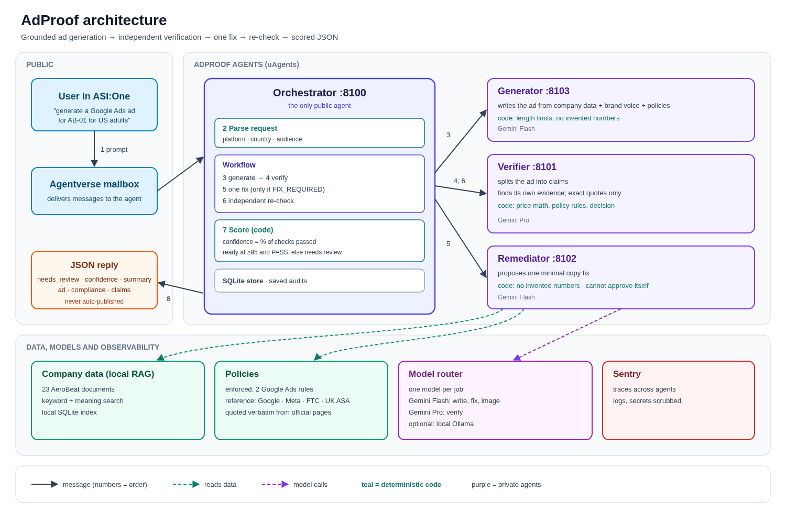

# AdProof

AdProof checks ads (image or text) for compliance, fixes them when possible, and generates compliant new ads. Every result is independently verified against company data and platform policies and returned as scored JSON. Nothing is auto-published; this is not legal advice or platform approval.

## 1. Architecture



1. A user sends an ad prompt to the Agentverse mailbox.
2. The orchestrator parses the request and selects the workflow.
3. The generator retrieves company data and drafts the ad.
4. The verifier checks claims, evidence, image context, and active policies.
5. If the result is `FIX_REQUIRED`, the remediator proposes at most one copy-only fix.
6. The verifier independently re-checks the revised copy against the evidence.
7. Code scores the final audit using deterministic checks.
8. The orchestrator returns the JSON result to the same chat.

| Agent | Port | Model used by the agent |
|---|---:|---|
| Orchestrator | 8100 | Gemini Flash for image inspection; coordinates the workflow |
| Verifier | 8101 | Gemini Pro for claim extraction and evidence assessment |
| Remediator | 8102 | Gemini Flash for copy-only repairs |
| Generator | 8103 | Gemini Flash for ad generation |

The architecture diagram is also available as [SVG](docs/images/architecture.svg). See [architecture details](docs/architecture.md) for component boundaries.

## 2. Key design rules

- Models write and read; code makes the decisions.
- The verifier retrieves its own evidence and requires exact source quotes.
- There is at most one copy repair, and every repair is independently re-checked.
- Deterministic checks reject unsupported or invented numbers.
- Minors, Meta, and out-of-scope requests require human review.

## 3. Output

This real result is shortened to two of the six claims in `runtime/samples/simple_generate.json`.

```json
{
  "audit_id": "1a283c316022444bb1d95e0066111de7",
  "needs_review": false,
  "confidence": 100,
  "summary": "Ready to run: all 6 claims are backed by company data; 2 Google Ads rules passed.",
  "ad": {
    "platform": "google_ads",
    "headlines": ["AeroBeat AB-01 Headphones", "Wireless Over-Ear Headphones", "Now $60 Regular Price $80"],
    "descriptions": [
      "AeroBeat AB-01 wireless over-ear headphones. Get up to 30 hours battery life with ANC off.",
      "Save 25% on AeroBeat AB-01 headphones. IPX4 splash-resistant with 1-year limited warranty."
    ],
    "final_url": "https://aerobeat.example/products/ab-01"
  },
  "compliance": "OK",
  "claims": [
    {
      "claim": "You get up to 30 hours of battery life with ANC off.",
      "quote": "Battery life is up to 30 hours with active noise cancellation (ANC) off",
      "source": "AeroBeat AB-01 headphones product page › Battery"
    },
    {
      "claim": "The AeroBeat AB-01 headphones are IPX4 splash-resistant.",
      "quote": "The AB-01 is splash-resistant for everyday use and has an IPX4 rating.",
      "source": "AeroBeat AB-01 headphones product page › Durability and connectivity"
    }
  ]
}
```

- `confidence` is the share of deterministic checks passed, not a probability.
- Checks cover claims, active policy rules, coverage, unresolved issues, and processing errors.
- `needs_review` is false only for a `PASS` with confidence at or above 95 and no failed checks.
- `compliance` is `"OK"` when all checks pass, or a list of plain-language issues.
- The score is computed by code, not by a model; it is not a probability or platform approval.

## 4. Models

| Job | Default model | Why |
|---|---|---|
| Claim extraction | `gemini:gemini-3.1-pro-preview` | Pro handles the difficult claim-identification step. |
| Evidence assessment | `gemini:gemini-3.1-pro-preview` | Evidence judgment is hard; a different model from the writer reduces shared blind spots. |
| Ad generation | `gemini:gemini-3.5-flash` | Fast, lower-cost writing grounded in company data. |
| Copy remediation | `gemini:gemini-3.5-flash` | Fast, lower-cost fixing; code checks numeric changes. |
| Image inspection | `gemini:gemini-3.5-flash` | Reads the supplied image. |
| Default | `gemini:gemini-3.5-flash` | Baseline for jobs without a specialized default. |

The Pro model is a preview and adds latency. Override any job with its `ADPROOF_MODEL_*` setting. Optional Ollama routing is supported; with an Ollama default, claim extraction and evidence assessment inherit that default unless overridden. See [model and runtime setup](docs/setup.md).

## 5. Company data and RAG

The demo corpus contains 23 synthetic AeroBeat Markdown documents. Documents are split into heading-aware chunks; retrieval combines BM25 and `BAAI/bge-small-en-v1.5` embeddings with reciprocal-rank fusion (RRF). The chunks and embeddings are stored in the local SQLite index `runtime/corpus_index.sqlite3`.

To use your company data, put `.md` files directly under `data/corpus/aerobeat/`. Required YAML front matter is `doc_id`, `title`, `url`, and `doc_type`; `product_id` is optional but useful for product-specific documents. Use `doc_type: product_page` for product pages and set that document's `url` to the desired ad `final_url`.

`CORPUS_PATH` is fixed in code; it is not configurable through an environment variable. The index checks document hashes and rebuilds when the corpus changes. Rebuild manually with `uv run python -m adproof.rag.index build --force`.

## 6. Policies

Two Google Ads rules are actively enforced. The official, verbatim reference library has 19 entries: Google Ads 7, Meta 3, FTC 6, and UK ASA 3. Run `uv run python scripts/verify_policy_library.py` to check the stored excerpts against their sources; see the [policy library](docs/policy-library.md).

Meta has no active enforcement rules yet: the verified Meta references do not establish a supported product-claims predicate for automated enforcement, so Meta requests require human review.

## 7. Run it locally

### Prerequisites

- Git, Python 3.11, and [uv](https://docs.astral.sh/uv/).
- A Gemini API key with billing enabled for live Gemini model calls.
- Network access to Python package indexes, Hugging Face (first index build), Google Gemini (live calls), and Agentverse (mailbox use).
- Ports 8100–8103 free for the local agents.
- An Agentverse account for mailbox setup and an [ASI:One](https://asi1.ai) account for chat use.
- Optional: a Sentry DSN for telemetry, or Docker and Docker Compose for container hosting.

### 1. Clone and install

Run these from a terminal:

```sh
git clone https://github.com/Rathish-Rajendran/AdProof.git
cd AdProof
uv sync
uv run pytest -q
```

The offline tests need no Gemini key or running agents. The first `uv sync` installs the locked Python dependencies.

### 2. Configure

If `.env` already exists, leave it unchanged. Only for a new checkout without `.env`, copy the example:

```sh
cp .env.example .env
```

Edit `.env` privately and add `GEMINI_API_KEY` for live Gemini calls; the other values in the example are safe defaults. Don't leave `SENTRY_TRACES_SAMPLE_RATE` or `ADPROOF_RUNTIME_DIR` blank: an empty sample rate causes a `ValueError`, and an empty runtime directory writes state into the current directory. `.env` is ignored by Git; never commit it.

| Variable | Purpose and default | Required? |
|---|---|---|
| `GEMINI_API_KEY` | Credential for Gemini-routed jobs; unset in the example. | Yes for live Gemini calls; no for offline tests or offline generation. |
| `ADPROOF_MODEL_DEFAULT` | Default `gemini:gemini-3.5-flash`. | No; only set to change the default provider/model. |
| `ADPROOF_MODEL_IMAGE_INSPECTION` | Default `gemini:gemini-3.5-flash`. Set to `ollama:qwen2.5vl:3b` when using that Ollama vision model. | No; image audits need a compatible model if you override it. |
| `ADPROOF_MODEL_CLAIM_EXTRACTION` | Empty means Gemini Pro when the default is Gemini; otherwise inherits the default provider/model. | No; set to override the claim-extraction job. |
| `ADPROOF_MODEL_EVIDENCE_ASSESSMENT` | Empty means Gemini Pro when the default is Gemini; otherwise inherits the default provider/model. | No; set to override the evidence-assessment job. |
| `ADPROOF_MODEL_AD_GENERATION` | Empty means inherit `ADPROOF_MODEL_DEFAULT`. | No; set to override ad generation. |
| `ADPROOF_MODEL_COPY_REMEDIATION` | Empty means inherit `ADPROOF_MODEL_DEFAULT`. | No; set to override copy remediation. |
| `ADPROOF_WORKFLOW_DEADLINE_SECONDS` | Workflow deadline; default `600` seconds. | No. |
| `OLLAMA_BASE_URL` | Ollama endpoint; default `http://127.0.0.1:11434`. Compose uses its internal Ollama service address. | Only when using Ollama. |
| `SENTRY_DSN` | Sentry telemetry destination; unset by default. | No. |
| `SENTRY_ENVIRONMENT` | Sentry environment label; default `development` only when unset. The example is blank, so set it to `development` if sourcing `.env`. | No. |
| `SENTRY_TRACES_SAMPLE_RATE` | Sentry trace sample rate (`0`–`1`). The example sets `0`; must not be blank. | No. |
| `ORCHESTRATOR_SEED`, `VERIFIER_SEED`, `REMEDIATOR_SEED`, `GENERATOR_SEED` | Optional stable private identity seeds; blank by default, so random seeds are saved in `runtime/agent-seeds.json`. | No for local use; set or preserve them to keep deployed addresses stable. |
| `ADPROOF_RUNTIME_DIR` | Runtime state directory. The example sets `runtime`; must not be blank. | No. |
| `ADPROOF_SOURCE_ALLOWLIST` | Optional comma-separated `host=/path` allowlist for fetched sources; unset means no custom allowlist, but public-HTTPS safety checks still apply. | No. |
| `ADPROOF_MAILBOX_ENABLED` | Enable the orchestrator mailbox with `1`; default `0`. | Only for Agentverse/ASI:One mailbox use. |
| `ADPROOF_ORCHESTRATOR_HANDLE` | Optional published Agentverse handle; unset by default. | No; only if you configure a public handle. |
| `ADPROOF_MODEL_PROVIDER` | Legacy default-provider selector; defaults to `gemini` and is used only when `ADPROOF_MODEL_DEFAULT` is unset. | No; prefer `ADPROOF_MODEL_DEFAULT`. |
| `GEMINI_MODEL` | Legacy Gemini model name; default `gemini-3.5-flash`, used when no explicit default model is set. | No; prefer a `gemini:<model>` spec. |
| `OLLAMA_MODEL` | Legacy Ollama model name; default `qwen2.5:3b` when the legacy provider is Ollama. | No; prefer an `ollama:<model>` spec. |
| `ORCHESTRATOR_PORT`, `VERIFIER_PORT`, `REMEDIATOR_PORT`, `GENERATOR_PORT` | Port overrides; defaults are `8100`, `8101`, `8102`, and `8103`. | No; `run_all.sh` health-checks fixed default ports, so custom ports need custom supervision. |
| `ORCHESTRATOR_HOST`, `VERIFIER_HOST`, `REMEDIATOR_HOST`, `GENERATOR_HOST` | Agent bind/peer hosts; default `127.0.0.1`; Compose sets Docker service names. | No; for custom networking only. |
| `ADPROOF_TRANSPORT_PROBE` | Internal transport-test switch; unset/off by default. | No; do not enable for normal use. |
| `PROOF_JSON` | Internal value generated by `scripts/run_transport_proof.sh` for its own result check. | No; do not set manually. |

The Python settings and local scripts do **not** load `.env` automatically. In the same shell that will run local commands, export its values:

```sh
set -a; source .env; set +a
```

Repeat this in each new terminal. A running agent keeps its startup environment; after editing `.env`, stop and restart the local agents.

### 3. Try it without agents

Build the local corpus index explicitly:

```sh
uv run python -m adproof.rag.index build
```

The first build downloads the approximately 64 MiB `BAAI/bge-small-en-v1.5` model from Hugging Face. Use `--force` to rebuild an unchanged corpus:

```sh
uv run python -m adproof.rag.index build --force
```

Generate in-process with Gemini:

```sh
uv run python -m adproof.generate "Generate a Google Ads ad for AeroBeat AB-01 headphones for US adults"
```

Run the same workflow with fake models and no Gemini key:

```sh
uv run python -m adproof.generate --offline "Generate a Google Ads ad for AeroBeat AB-01 headphones for US adults"
```

Offline generation is a smoke test, not a quality example: its scripted draft includes an unsupported “waterproof” claim, so it is expected to return `needs_review: true`. The command prints its JSON report to standard output. The explicit index build writes `runtime/corpus_index.sqlite3`; agents store workflow reports in `runtime/adproof.sqlite3`.

### 4. Start the agents

The startup script is not executable directly; invoke it with `bash`:

```sh
bash scripts/run_all.sh
```

It prepares runtime identities and the corpus index, then starts verifier (8101), remediator (8102), generator (8103), and orchestrator (8100). It polls `/health` on ports 8100–8103 for up to 30 seconds each, writes logs to `runtime/<role>.log`, and stays in the foreground. Press Ctrl-C to stop all four child processes.

Check the orchestrator:

```sh
curl -fsS http://127.0.0.1:8100/health
```

Check all four agents:

```sh
for port in 8100 8101 8102 8103; do
  printf '%s: ' "$port"
  curl -fsS "http://127.0.0.1:$port/health"
  printf '\n'
done
```

Alternatively, `uv run python -m adproof.status` reports all health states and addresses.

### 5. Find your agent address

The uAgents startup log includes `Starting agent with address`; for the orchestrator, inspect `runtime/orchestrator.log`. Runtime preparation also writes public addresses to `runtime/agents.json`.

Private seeds are stored separately in `runtime/agent-seeds.json` with owner-only file permissions. Do not share or commit this file. Keeping the same seeds preserves the derived addresses; a fresh clone creates different addresses unless you deliberately copy the private seeds or configure the `*_SEED` variables.

The public demo orchestrator address is `agent1q0lpgrz6c80h2n5ns0vw5sq0wtrp8gkm92x3pl6n5hwru7z0f47977ntemy`. Your fresh local runtime will usually have a different one.

## 8. Use it from ASI:One

### Connect the mailbox

1. Set `ADPROOF_MAILBOX_ENABLED=1` in `.env`, export it in the same shell, and start the agents.
2. Open the inspector URL printed in `runtime/orchestrator.log` in a browser on the **same machine** as the orchestrator. The inspector calls `127.0.0.1:8100`.
3. Sign in to Agentverse, select **Connect → Mailbox**, and finish the flow. Leave the “Check your agent” dialog unchanged.
4. The insufficient-funds Almanac contract warning is harmless; mailbox API registration does not require crypto.
5. Verify the current address is active:

   ```sh
   curl -fsS "https://agentverse.ai/v1/almanac/agents/<address>"
   ```

   Replace `<address>` with the orchestrator address from `runtime/agents.json`. Connect the mailbox again whenever the address changes.

### Send a request

Open [ASI:One](https://asi1.ai). Select `adproof-orchestrator` in the **To:** box, or begin each message with `@<address>`. Without a recipient or leading mention, the message goes to ASI:One's own AI.

| Input | What it does |
|---|---|
| Upload an ad image (optional caption) | Checks visible text and policies. Any original issue needs review; passing replacement text is only a suggestion in `fixed_text`. |
| `check <ad text>` | Checks text, attempts one copy-only fix when possible, and independently re-checks it. |
| `generate <prompt>` | Generates a corpus-grounded ad, then independently preflights it. |
| `help` or `?` | Lists supported commands and input forms. |
| `demo aerobeat` | Audits the unsafe-copy demo and can attempt one copy-only repair. |
| `demo aerobeat49` | Demonstrates that a copy repair cannot fix the `$49` shown in the image. |
| `demo aerobeat correct` | Audits the already-correct AeroBeat demo. |
| `example` | Returns a sample `CampaignInput` JSON object. |
| Fenced `CampaignInput` JSON | Submits a full campaign using the documented schema. |
| `Image:`, `Copy:`, `Page:` fields | Submits a simple campaign; include all three fields on separate lines. |
| `status <audit_id>` | Shows the workflow state. |
| `report <audit_id>` | Re-renders a saved report in the current JSON format. |
| Card action | `Show report` and `Status` actions are accepted; `Run one repair` is valid only for an unrepaired `FIX_REQUIRED` audit. |

`status` and `report` are bound to the same sender and chat session that created the audit. Use the same chat; reports expire after 24 hours. Typical successful live runs have taken about 20–40 seconds, but model, network, and quota delays can make them longer. Image audits may take longer because they add an inspection call; image inspection itself uses Flash, while claim extraction and evidence assessment use Pro.

Try these prompts:

- Upload an AeroBeat AB-01 ad image, optionally captioned `AeroBeat AB-01 headphones` → image checks; any original issue still needs review, with suggested text in `fixed_text`.
- `check AeroBeat AB-01 headphones are completely waterproof. Get 48-hour battery life. Now $60—50% off!` → checks the claims and may repair unsupported copy once.
- `generate a Google Ads ad for AeroBeat AB-01 headphones for US adults` → expected ready result (`needs_review: false`) for the current supported example.
- `generate a Google Ads ad for AeroBeat AB-02 Pro earbuds for teens` → expected human review with a minors-scope note.

Live model output can vary; a human-review result is safer than treating an unsupported claim as approved.

## 9. Keep it running with Docker

Use Docker Compose on an always-on host; sleep or shutdown stops local agents. If `.env` does not exist, create it with `cp .env.example .env` and do not overwrite an existing file. Compose loads `.env` for its services, so no shell export is needed. Configure the key and `ADPROOF_MAILBOX_ENABLED=1`, then run:

```sh
docker compose config -q
docker compose up --build -d
docker compose ps
docker compose logs -f orchestrator
```

Compose publishes `8100:8100` for the orchestrator; specialist ports stay inside the Compose network. Open the inspector URL in a browser on the Docker host. The named `runtime` volume preserves seeds and reports across container restarts. If moving to another host, copy the private seed values into `ORCHESTRATOR_SEED`, `VERIFIER_SEED`, `REMEDIATOR_SEED`, and `GENERATOR_SEED` in its `.env`; do not publish them.

For optional local Ollama, set `ADPROOF_MODEL_DEFAULT=ollama:qwen2.5:3b` and `ADPROOF_MODEL_IMAGE_INSPECTION=ollama:qwen2.5vl:3b`, then start the profile:

```sh
docker compose --profile ollama up --build -d
docker compose --profile ollama exec ollama ollama pull qwen2.5:3b
docker compose --profile ollama exec ollama ollama pull qwen2.5vl:3b
```

After changing `.env`, run `docker compose up --build -d` to recreate containers with the new values. Use `docker compose down` to stop the stack; do not remove volumes if you need to preserve deployed identities or Ollama models. See [setup and operations](docs/setup.md).

## 10. Troubleshooting

| Symptom | What to do |
|---|---|
| Port 8100–8103 is already in use | Stop only the conflicting process you own, or run on a host with free ports. The local supervisor health-checks these default ports. |
| `Waiting to acquire exclusive lock for .venv` | Harmless when another `uv` command is installing or syncing. Let it finish; avoid overlapping installs. |
| Hugging Face model download fails | Check Hugging Face network access and retry `uv run python -m adproof.rag.index build`. |
| `401 MODEL_AUTH` | The process has a stale or invalid Gemini key. Update `.env`, export it, and restart agents. |
| `429` or quota exhaustion | Check Gemini quota and billing; wait for quota recovery or use a configured alternative. |
| `404` model not found | The model name may be unavailable or a preview may have retired. Set a supported `ADPROOF_MODEL_*` spec and restart. |
| “Reply too large” | This transport issue has been fixed; it should no longer occur. |
| No reply in ASI:One | Select `adproof-orchestrator` or prefix the message with `@<address>`; then confirm the mailbox is connected. |
| Mailbox is not connected | Repeat the Agentverse **Connect → Mailbox** flow and confirm the Almanac API reports the address active. |
| `HUMAN_REVIEW` for Meta, minors, or out-of-scope input | Expected. Those requests are not covered by the active adult-audience policy scope. |
| Slow response | Pro is a preview model; image inspection and provider/network load add time. Check the role logs and the 600-second workflow deadline. |
| `report` says the audit is unavailable | Use the same sender and ASI:One chat session that created it; saved reports expire after 24 hours. |

## 11. Project layout

```text
adproof/              Workflow, domain, verifier, generator, RAG, and report code
agents/               Four uAgents entry points and orchestrator
data/corpus/aerobeat/  Synthetic company Markdown
data/policies/        Enforced rules and official reference library
docs/                 Architecture, setup, policy, and validation details
scripts/               Runtime preparation and verification utilities
tests/                 Offline unit and workflow tests
runtime/               Local index, SQLite reports, addresses, seeds, and logs (ignored)
```

For setup details, see [setup and operations](docs/setup.md); for the implementation overview, see [architecture](docs/architecture.md). Current test and live-validation notes are in [validation status](docs/validation-status.md).

## 12. Limits and scope

- AdProof does not publish ads, provide legal advice, or guarantee platform approval.
- Results cover only supplied company evidence and the small set of actively enforced rules.
- Images are never edited; copy is repaired at most once, and minors, Meta, or out-of-scope requests require human review.
