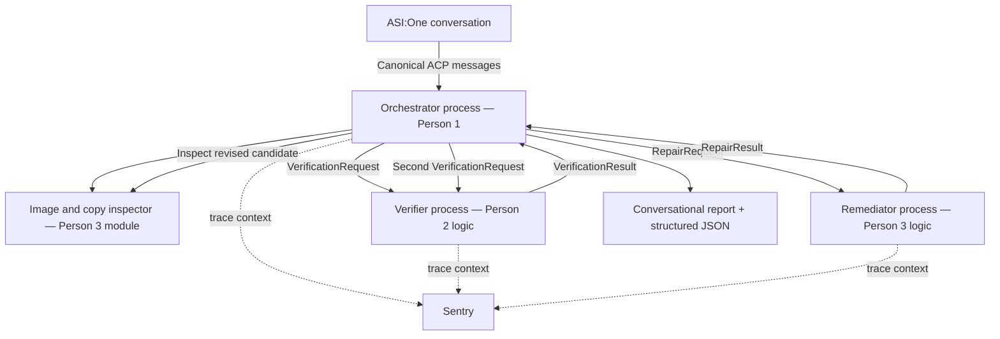

# Plan 1 — Agent infrastructure and orchestration

**Project:** AdProof  
**Owner:** Person 1  
**Implementation audience:** the teammate coordinating Person 1, a Codex planning session, and Devin  
**Research checked:** October 17, 2026  
**Deliverable type:** implementation specification; application code has not been built by this document.

**Repository placement:** copy this delivered file into `<repository-root>/docs/Plan_1_Agent infrastructure and orchestration.md`. In the tree below, `adproof/` means the existing repository root, not an extra nested checkout. When this plan refines the earlier README, use this plan for Person 1 and distribute the refinement to both teammates.

## 1. What you are responsible for

Build the system that receives a campaign from ASI:One, calls the right specialists, preserves the evidence and decisions they return, handles failures, and delivers an understandable audit report.

Your success criterion is:

> A judge opens AdProof in ASI:One, submits an image URL, ad copy, and landing-page URL, and receives an original decision, a proposed copy repair, and a separately verified decision for the repaired campaign. The same audit can be followed through the agent logs and Sentry.

Your responsibility is the working pipeline. Person 2 supplies evidence and policy intelligence. Person 3 supplies image inspection and copy repair. You provide the interfaces and the infrastructure that let those components work together.

This plan refines the earlier project README. Share sections 4–8 with both teammates before they ask their own coding agents to implement anything. The refinements preserve the existing input structure and decision enums, specify previously undefined internal messages, and add explicit execution/error information to the output.

### Read this first: three decisions that affect the build

1. **Mailbox delivery is not application hosting.** Three Python processes must remain running on the team's computer or an external runtime. Agentverse mailboxes relay their messages. Registering the agents does not keep those processes alive.
2. **Using Devin to build is the primary Cognition integration.** The current October event lists “Cognition — Best Use of Devin.” A runtime MCP integration is optional; the public listing does not establish that it is required. Earlier advice based on the “Augment the Agent” challenge from a different LA Hacks event should not determine this implementation. Preserve Devin's session, commits, tests, and PR evidence. [October event listing](https://la-ai-hackathon-2026.devpost.com/)
3. **A copy rewrite cannot fix text inside an unchanged image.** If “CLINICALLY PROVEN” and “50% OFF” are still visible in the image and fail verification, the repaired campaign can remain `BLOCK`. `HUMAN_REVIEW` is for uncertainty, not a way to downgrade a known unresolved critical issue.

## 2. Research findings translated into decisions

| Verified finding | Decision for Person 1 |
|---|---|
| Fetch requires Agentverse registration, ACP, direct ASI:One use, meaningful tool execution, and a public repo. | Make a real ASI:One echo round trip your first live milestone. |
| The official tutorial documents `uagents==0.25.5` and `AgentChatProtocol 0.3.0`. | Use this reproducible baseline and lock the resolved dependency graph. It is a documented baseline, not a claim about the latest release. |
| uAgents 0.25.5 declares Pydantic v2 compatibility. | Use Pydantic v2 for business schemas and `uagents.Model` for transport envelopes. |
| Mailbox agents can run outside the Agentverse hosted editor. | Run the whole repository externally; do not paste the app into a restricted hosted editor. |
| ACP requires canonical message types and acknowledgements. | Import the actual protocol classes; do not implement a lookalike JSON protocol. |
| Current Devin docs support repository setup, environment blueprints, and encrypted secrets. | Give Devin a configured repository, this plan, fixtures, commands, and checkpoint tests. |
| Sentry provides custom trace propagation APIs. | Carry trace headers between the trusted agents; a shared request ID alone does not join their traces. |

Sources: [Fetch October hackpack](https://innovationlab.fetch.ai/events/hackathons/la-hacks-ai-hackathon-2026/hackpack), [official ACP tutorial](https://innovationlab.fetch.ai/resources/docs/examples/chat-protocol/asi-compatible-uagents), [versioned package metadata](https://pypi.org/pypi/uagents/0.25.5/json), [agent creation and registration](https://innovationlab.fetch.ai/resources/docs/agent-creation/uagent-creation), [Devin environment setup](https://docs.devin.ai/onboard-devin/environment), [Sentry Python API](https://getsentry.github.io/sentry-python/api.html).

These are implementation decisions informed by documentation. The numeric timeouts, concurrency limits, cache duration, filenames, and acceptance thresholds below are our project choices, not platform guarantees.

## 3. Concrete use cases

### UC-1: Unsafe copy, neutral product image, successful copy repair

**User:** a growth marketer reviewing a wellness campaign before launch.

**Input:**

- Neutral product image containing only “Acme Balance.”
- Copy: “Lose 20 pounds in two weeks—clinically proven. Recommended by doctors. Today only: 50% off.”
- Landing page: Acme Balance; current price $39.99; previous price $49.99; no study or endorsement.
- Google Ads, United States, adults, health/wellness.

**Expected flow:**

1. Orchestrator validates the campaign and generates an audit ID.
2. Person 3's inspector extracts the claims from the copy and image.
3. The verifier returns `BLOCK`, with unsupported health/clinical claims and a pricing contradiction.
4. The remediator proposes factual copy such as: “Acme Balance. $39.99, previously $49.99.”
5. The inspector examines this new copy together with the same neutral image.
6. The verifier evaluates the new candidate and can return `PASS` for the configured checks.
7. The report displays the original decision, exact repair, final decision, and evidence references.

**What this proves about your work:** real routing, schema handling, two verification passes, and an output whose final decision belongs to the actual revised candidate.

### UC-2: Unsafe image remains blocked after copy repair

Use the same copy and page, but the image itself says “CLINICALLY PROVEN” and “50% OFF.”

**Expected:** the copy can improve, but reinspection must retain the image claims. If a critical image claim remains unsupported, the new decision remains `BLOCK`. The response explains that the advertiser must replace the image and submit the complete campaign again.

For a clean second demo, Person 3 manually supplies a neutral replacement image and the user submits a new request. Automatic image generation/editing is outside the MVP.

### UC-3: A dependency fails

The landing page returns 503, Gemini times out, or the verifier does not respond.

**Expected:** bounded retry when appropriate, a partial report with a stage-specific error, and `HUMAN_REVIEW` when no trustworthy decision is available. If a validated critical issue is already known, preserve `BLOCK` and explain the incomplete work separately. Never fabricate a successful audit to keep the demo moving.

### UC-4: Duplicate delivery and a later response

The same chat message is delivered twice, or a specialist reply arrives after its deadline.

**Expected:** transport acknowledgements remain correct, only one logical audit starts, duplicate specialist results do not advance the state twice, and a late response cannot change a terminal report.

## 4. Frozen architecture and ownership

### 4.1 Runtime architecture



- Three Python processes, each with a distinct stable seed and agent address.
- One public conversational entry point: `adproof-orchestrator`.
- Two specialist roles: `adproof-verifier` and `adproof-remediator`.
- Image inspection is an imported async component in the orchestrator process. Its intelligence is owned by Person 3.
- All three are registered through Agentverse mailboxes; only the orchestrator must expose the user-facing ACP workflow.
- The verifier and remediator exchange structured messages with the orchestrator.
- A local command-line runner exercises the same workflow with fake gateways for offline tests.
- The live workflow has no custom web frontend and no required ASI inference API call. ASI:One chat is the entry channel; Gemini is the configured model service used by teammate components.

### 4.2 File ownership

| Area | Person 1 owns | Teammate owns |
|---|---|---|
| Shared contracts | `shared/schemas.py`, `shared/messages.py`, exported JSON schemas | Both teammates consume them unchanged. |
| Application control | `orchestrator/workflow.py`, state, correlation, error handling | No teammate duplicates this logic. |
| ACP | `orchestrator/chat_protocol.py`, input adapter, output delivery | Person 3 may supply optional card layout. |
| Image inspection | Fetch/validate/cache one image snapshot, invocation, time limit, result validation | Person 3 implements `orchestrator/image_inspector.py` using the supplied bytes. |
| Verification | `verifier/agent.py` transport wrapper | Person 2 implements `verifier/service.py` and evidence/policy modules. |
| Copy repair | `remediator/agent.py` transport wrapper | Person 3 implements `remediator/repair.py`. |
| Gemini client | `shared/model_client.py`: credentials, async calls, limits, error translation | Person 2/3 own prompts, extraction behavior, and schemas for their outputs. |
| Observability | Sentry setup, correlation fields, trace propagation | Teammates add nested business spans if useful. |
| Retrieval protection | Common URL-validation helper if shared | Each component that actually fetches a URL must enforce it at fetch time. |
| Deployment | Launcher, configuration, agent profiles, registration/runbook | Each owner supplies their needed dependencies. |

If each person uses a separate Codex/Devin session, use one repository with separate branches. Person 1 lands the shared contracts first. The other sessions branch from that commit. Only Person 1 changes shared contracts and the dependency lockfile during integration; teammates propose changes through that owner.

This is a coordination convention for the team. It does not require one coding agent to wait for another before implementing its own mocked slice.

## 5. Input and output contracts

### 5.1 User input: `CampaignInput`

```json
{
  "schema_version": "1.0",
  "request_id": "campaign-demo-001",
  "creative": {
    "format": "IMAGE",
    "image_url": "https://YOUR_FIXTURE_HOST/neutral-product.png",
    "ad_copy": "Lose 20 pounds in two weeks—clinically proven. Recommended by doctors. Today only: 50% off."
  },
  "landing_page_url": "https://YOUR_FIXTURE_HOST/acme-balance.html",
  "campaign": {
    "platform": "GOOGLE_ADS",
    "jurisdiction": "US",
    "audience": "Adults in the United States",
    "category": "HEALTH_WELLNESS"
  },
  "evidence_documents": []
}
```

`YOUR_FIXTURE_HOST` is an explicit placeholder. Replace it with an actual public HTTPS host before live use. Example URLs and `localhost` links are not working ASI:One fixtures.

| Field/model | Definition |
|---|---|
| `schema_version` | Literal `1.0`; reject unsupported versions. |
| `request_id` | 1–80 URL-safe characters. Generate a UUID if omitted at the chat adapter; normalized internal requests always have one. |
| `creative.format` | Literal `IMAGE`. |
| `creative.image_url` | Public HTTPS URL; image fetcher accepts PNG/JPEG, maximum 10 MB. |
| `creative.ad_copy` | 1–2,000 characters. |
| `landing_page_url` | Public HTTPS URL. One HTML page; no recursive crawl. |
| `campaign.platform` | MVP literal `GOOGLE_ADS`. Explicit unsupported platform returns an input error. |
| `campaign.jurisdiction` | MVP literal `US`. |
| `campaign.audience` | 1–300 characters. |
| `campaign.category` | MVP literal `HEALTH_WELLNESS`. |
| `evidence_documents` | Default `[]`; maximum five `EvidenceDocument` objects: `{url, label}`. MVP accepts HTML evidence; PDF support is a later capability and must not be silently assumed. |

Use `extra="forbid"` on input models. Reject empty copy and placeholder configuration values in live mode. Allow fixture URL interception only in the explicitly mocked runner.

### 5.2 Friendly chat input

Support canonical JSON first, plus this fixed labeled format:

```text
Audit this campaign.
Ad image: https://YOUR_FIXTURE_HOST/neutral-product.png
Ad copy: Lose 20 pounds in two weeks—clinically proven. Recommended by doctors. Today only: 50% off.
Landing page: https://YOUR_FIXTURE_HOST/acme-balance.html
Platform: GOOGLE_ADS
Jurisdiction: US
```

The parser may apply the documented adult/health-wellness defaults when context fields are omitted, and must display them in the report. Do not guess which of two unlabeled URLs is the image.

If essential fields are missing, respond with a short request for those fields. Do not call any specialist. The base implementation is stateless between incomplete input attempts: ask the user to resend the complete labeled request. This avoids promising multi-turn memory that has not been implemented. Optional guided cards can improve this later.

`help`, `example`, `status <audit_id>`, and `report <audit_id>` are deterministic commands; they must not be sent to Gemini.

### 5.3 Required shared business models

Implement these once in `shared/schemas.py` and export their JSON schemas. The field lists below are the source of truth for the first implementation.

| Model | Required fields |
|---|---|
| `AtomicClaim` | `claim_id: str`, `claim: str`, `source: ClaimSource`, `claim_type: ClaimType` |
| `VisualAssertion` | `description: str`, `confidence: float` in `[0,1]` |
| `InspectionResult` | `request_id`, `visible_text: list[str]`, `visual_assertions: list[VisualAssertion]`, `atomic_claims: list[AtomicClaim]`, `inspection_warnings: list[str]`, `image_sha256: str` |
| `EvidenceRef` | `source_type`, `source_url`, `excerpt`, `relation` |
| `VerifiedClaim` | All `AtomicClaim` fields plus `status`, `evidence: list[EvidenceRef]`, `confidence: float` in `[0,1]` |
| `PolicyRef` | `authority`, `title`, `url` |
| `Issue` | `issue_id`, `category: str`, `severity`, `explanation`, `policy: PolicyRef or null`, `related_claim_ids: list[str]`, `suggested_fix`, `auto_fixable: bool` |
| `VerificationRequest` | `candidate_id`, `phase`, `campaign: CampaignInput`, `inspection: InspectionResult` |
| `VerificationResult` | `candidate_id`, `phase`, `claims: list[VerifiedClaim]`, `issues: list[Issue]`, `decision`, `retrieval_warnings: list[str]`, `policy_pack_version`, `source_snapshots: list[SourceSnapshot]` |
| `SourceSnapshot` | `source_url`, `fetched_at` in UTC, `content_sha256` |
| `RepairChange` | `reason`, `related_issue_ids: list[str]` |
| `RepairRequest` | `candidate_id`, `campaign: CampaignInput`, `verification: VerificationResult` |
| `RepairResult` | `repaired_copy`, `changes: list[RepairChange]`, `unresolved_issue_ids: list[str]` |
| `WorkflowError` | `code`, `stage`, `message`, `retryable: bool` |

Freeze the enums:

- `Decision`: `PASS | FIX_REQUIRED | BLOCK | HUMAN_REVIEW`
- `ClaimStatus`: `SUPPORTED | CONTRADICTED | INSUFFICIENT`
- `Severity`: `INFO | WARNING | MAJOR | CRITICAL`
- `ClaimSource`: `AD_COPY | IMAGE_TEXT | IMAGE_VISUAL | IMAGE_AND_AD_COPY`
- `ClaimType`: `HEALTH_OUTCOME | CLINICAL_EVIDENCE | ENDORSEMENT | PRICE_DISCOUNT | PRODUCT_FACT | OTHER`
- `EvidenceSource`: `LANDING_PAGE | DOCUMENT | POLICY`
- `EvidenceRelation`: `SUPPORTS | CONTRADICTS | CONTEXT`
- `Phase`: `ORIGINAL | REPAIRED`

`image_sha256` refers to the actual image bytes inspected. Person 1's `shared/media.py` fetches and validates the image once, computes its digest, and stores the bytes in the active audit's snapshot cache. Pass those exact bytes to both inspections and assert that both returned hashes match the stored digest. This prevents a mutable image URL from silently pointing to different creative between passes. The bytes stay local; agent messages carry hashes and extracted content, not base64. A missing snapshot is a component failure; do not silently refetch the URL during re-audit.

Person 2 decides what the evidence supports and the rule severities. Missing clinical evidence means `INSUFFICIENT`, not automatically “the claim is scientifically false.” Person 1 enforces structure and workflow integrity rather than inventing business findings.

### 5.4 Final response: `AuditReport`

Retain the previous README fields and add the following explicit workflow fields. Define `initial_decision: Decision | null`, `repair: RepairResult | null`, `repaired_decision: Decision | null`, and `repaired_verification: VerificationResult | null`. An early failure has no validated original decision; its `initial_decision` is `null`. Some audits legitimately stop before repair or never need it. `final_decision` always expresses the user-facing result, including a human-review fallback for an incomplete audit.

```json
{
  "schema_version": "1.0",
  "request_id": "campaign-demo-001",
  "audit_id": "audit_8fa61a89",
  "execution_mode": "LIVE",
  "workflow_status": "COMPLETED",
  "initial_decision": "BLOCK",
  "claims": [],
  "issues": [],
  "repair": {
    "repaired_copy": "Acme Balance. $39.99, previously $49.99.",
    "changes": [],
    "unresolved_issue_ids": []
  },
  "repaired_decision": "PASS",
  "final_decision": "PASS",
  "final_candidate_id": "candidate_repaired_8fa61a89",
  "repaired_verification": {
    "candidate_id": "candidate_repaired_8fa61a89",
    "phase": "REPAIRED",
    "claims": [],
    "issues": [],
    "decision": "PASS",
    "retrieval_warnings": [],
    "policy_pack_version": "demo-v1",
    "source_snapshots": []
  },
  "human_review_reasons": [],
  "errors": [],
  "provenance": {
    "policy_pack_version": "demo-v1",
    "model_outputs_are_advisory": true,
    "image_sha256": "<actual inspected image digest>",
    "source_snapshots": []
  },
  "timings_ms": {
    "total": 42000
  }
}
```

This example illustrates report structure only; the real implementation must populate claims, issues, evidence, changes, and snapshots from validated specialist results. It must not emit empty claim arrays for the unsafe fixture and call that successful analysis.

`execution_mode` is `MOCK`, `TRANSPORT_TEST`, or `LIVE`. `workflow_status` is `COMPLETED`, `PARTIAL`, or `FAILED`. These describe execution, independently from ad safety.

Rules for the displayed decision:

1. `claims` and `issues` at the report's top level describe the original campaign.
2. A completed re-audit determines `repaired_decision`; otherwise it is `null`.
3. When a revised campaign has been fully verified, `final_decision` is its decision and `final_candidate_id` identifies that campaign.
4. Without a verified revised campaign, preserve a valid original decision. If further work failed after original `BLOCK`, final remains `BLOCK`.
5. If necessary inspection/evidence is unavailable and no valid decision exists, return `HUMAN_REVIEW`, the errors, and the incomplete scope.
6. Never label a proposed rewrite `PASS` because it was generated or because its JSON parsed.
7. `PASS` means no blocking issue in the supported checks and reviewed candidate; the report names its platform, jurisdiction, policy version, and retrieval time.

Person 2 owns the deterministic business decision policy: critical issue → `BLOCK`; unresolved high-risk uncertainty → `HUMAN_REVIEW`; repairable major issue → `FIX_REQUIRED`; otherwise `PASS` with any warnings. Person 1 must preserve a critical finding if a partial failure would otherwise hide it.

## 6. Interfaces that let the team work in parallel

### 6.1 Teammate function contracts

Give Person 2 this exact signature to implement:

```python
async def verify_campaign(
    request: VerificationRequest,
) -> VerificationResult: ...
```

Give Person 3 these signatures:

```python
async def inspect_creative(
    campaign: CampaignInput,
    *,
    frozen_image: bytes,
) -> InspectionResult: ...


async def repair_copy(
    request: RepairRequest,
) -> RepairResult: ...
```

Person 1 owns the image snapshot cache and always supplies `frozen_image`. Person 3's inspector must not fetch the image URL again; it reports the digest of the bytes actually inspected. Person 1 does not send image bytes to the verifier/remediator.

Both owners must:

- Return typed models, not prose or hand-written dictionaries.
- Raise a typed component error on inability to perform their function.
- Never return a fabricated `PASS` on an exception.
- Be importable without network calls or required API keys at module import time.
- Provide at least one known-good input/output fixture before integration.
- Keep dependencies in the agreed dependency manifest rather than installing ad hoc packages at runtime.

### 6.2 Person 1 gateway abstraction

The workflow engine uses a gateway interface with operations for inspection, verification, and repair. The engine must not import the Agentverse transport directly.

- `FakeGateway`: returns deterministic fixtures with optional simulated failures.
- `LiveGateway`: calls Person 3's local inspector and dispatches verification/repair messages to real agent addresses.
- A real transport test uses mock specialist business functions behind actual uAgents wrappers; reports are always labeled `TRANSPORT_TEST`.

The initial fake workflow and eventual live workflow must share state transitions, validation, decision presentation, and error handling.

### 6.3 Wire envelopes

Implement in `shared/messages.py` as canonical `uagents.Model` classes. Business models remain in `shared/schemas.py`. All three processes import these exact definitions.

**`SpecialistRequest` fields:**

| Field | Purpose |
|---|---|
| `schema_version: str` | `1.0` |
| `request_id: str` | User request correlation |
| `audit_id: str` | One workflow execution |
| `task_id: str` | One logical operation; stable across retries |
| `candidate_id: str` | Exact creative candidate being analyzed |
| `operation: str` | `VERIFY` or `REPAIR` |
| `phase: str` | `ORIGINAL` or `REPAIRED` |
| `attempt: int` | Starts at 1, maximum 2 |
| `deadline_at: str` | UTC timestamp; do not start expired work |
| `execution_mode: str` | Prevent mock/live confusion |
| `payload_json: str` | JSON serialization of the relevant business request |
| `trace_headers: dict[str, str]` | Optional `sentry-trace` and `baggage` |

**`SpecialistResponse` fields:** copy the correlation fields, then add `ok: bool`, `payload_json: str or null`, `error: WorkflowError or null`, and optional timing/trace metadata.

Validation requirements:

- Exactly one of success payload or error must exist.
- The receiver parses `payload_json` into `VerificationRequest` or `RepairRequest` based on the operation.
- The orchestrator parses the response into the expected result model; raw payload success is not sufficient.
- The actual SDK sender must match the configured verifier or remediator address. Do not trust an address merely written in the payload.
- At the specialists, allow only the configured orchestrator's actual SDK sender before any retrieval, model call, trace continuation, or business execution. A request payload cannot assert its own authorization.
- `audit_id`, `task_id`, `candidate_id`, operation, phase, and mode must all match an active pending task.
- The verifier's result phase/candidate must also match the request.
- Outgoing payload target: under 64 KB. This is our project budget, not a claimed platform limit. Cap excerpt counts/lengths; never silently discard a critical finding to fit the budget. Return a size error if necessary.

Using a JSON string inside a simple wire envelope keeps the transport schema stable while business objects remain strongly validated at both ends. Export the wire schema digest and contract version in diagnostics so a mismatch can be found quickly.

### 6.4 Keys and duplicate handling

- Before generating a missing `request_id`, deduplicate the ACP delivery by `(actual SDK sender, original session identity, ChatMessage.msg_id)`. Store its normalized request/audit ID. A repeated delivery gets an acknowledgement but resolves to that same logical audit.
- Application request key: `(caller identity, session identity, request_id)`.
- Store a normalized payload fingerprint with this key.
- Same key and same payload: return the existing status/report; do not call the model again.
- Same key but different payload: return `DUPLICATE_REQUEST_CONFLICT` and request a new ID.
- Specialist cache key: `(actual orchestrator sender, task_id)` plus payload fingerprint.
- A retry keeps `task_id`, increments `attempt`, and does not cause another business execution if the first is already running/completed.
- The repaired pass always gets a different `candidate_id` and `task_id` from the original pass.
- Keep completed replay records for ten minutes. A new request ID means a fresh audit and fresh retrieval.
- A cached report states its original retrieval time; it is not presented as a newly fetched assessment.

Each specialist task has an execution status: `RUNNING`, `SUCCEEDED`, `RETRYABLE_FAILED`, or `PERMANENT_FAILED`. A running duplicate waits for/reuses the original result without executing again; a successful duplicate replays the result. A retryable failed attempt may execute attempt 2 within the original deadline. A permanent failure cannot be retried. Fingerprint the immutable operation/candidate/business payload and exclude attempt numbers and tracing metadata. A retry does not extend the stage deadline.

For `status` and `report`, authorize the stored original SDK sender **and** session identity. Do not assume an ASI intermediary's sender address uniquely identifies a human. Prove session continuity for later commands in a live test. If the ownership context is absent or changes, refuse stored-report access; a guessable audit ID is not authorization. The original invocation must deliver its full report so later cross-session retrieval is unnecessary for the primary demo.

## 7. Orchestration state machine

### 7.1 States and transitions

```text
RECEIVED
  → VALIDATING
  → INSPECTING_ORIGINAL
  → VERIFYING_ORIGINAL
      ├─ Original PASS → COMPLETED
      ├─ No useful text repair possible → COMPLETED with original decision
      └─ Repairable text issue → REPAIRING_COPY
            → INSPECTING_REPAIRED
            → VERIFYING_REPAIRED
            → COMPLETED

Any required stage failure → PARTIAL or FAILED, with a safe final decision.
```

Use one repair attempt per audit. Do not build an unbounded generate-and-judge loop.

### 7.2 Exact orchestration algorithm

1. Acknowledge the incoming ACP message immediately.
2. Check the transport-delivery replay key before generating IDs; for a new delivery, normalize text into `CampaignInput` and return helpful validation errors if invalid.
3. Resolve duplicates, assign `audit_id`, and capture the original reply channel/session.
4. Record the audit deadline and begin the root Sentry trace.
5. Fetch and validate one bounded image snapshot through Person 1's media helper, then inspect those bytes and the original copy through Person 3's component.
6. Save the image snapshot/hash and validated `InspectionResult`.
7. Send `VerificationRequest` for the original candidate to the verifier.
8. Validate its result and record the original decision. Never overwrite it later.
9. If original is `PASS`, finish. If the issues cannot benefit from a text repair, finish and explain the needed human action.
10. Otherwise send a `RepairRequest` to the remediator.
11. Validate the returned `RepairResult`. Reject empty/unchanged copy when the response claims that substantive issues were fixed.
12. Construct a new `CampaignInput` by replacing only `creative.ad_copy`. Keep original image, platform, jurisdiction, and evidence context. Generate a new candidate ID.
13. Reinspect the new copy with the frozen original image bytes. Do not reuse the old copy claims or delete image claims.
14. Send a second `VerificationRequest`, now `phase=REPAIRED`.
15. Validate the re-audit and produce the full report.
16. Send a concise user summary, then the structured report through supported ACP text/report delivery.
17. Mark the invocation complete only after the final response is dispatched; record delivery failure if it fails.

### 7.3 Event-driven transport

Use `ctx.send` plus result handlers rather than keeping a message handler waiting for a specialist response. Official communication examples use typed requests/results, and `send_and_receive` is available, but the event-driven approach makes progress and deadline handling explicit. [uAgent communication](https://innovationlab.fetch.ai/resources/docs/agent-communication/uagent-uagent-communication), [request/response alternative](https://uagents.fetch.ai/docs/guides/send_receive)

The initial chat handler stores workflow state, starts/dispatches the next operation, and returns. A specialist result handler validates the reply, advances exactly one state, dispatches the next operation, and returns.

Use the supported `handle_messages_concurrently=True` setting where needed to keep acknowledgements responsive while async inspection runs. Guard transitions with an `asyncio.Lock` per audit and a limit of two active audits. Keep registry mutation atomic; do not use unguarded shared SDK storage as a concurrency primitive. All model/HTTP calls must be asynchronous or explicitly moved off the event loop.

**Session preservation is an implementation gate:** save the original caller, inbound session identity, and a runtime `ReplyChannel` adapter. In the baseline, this adapter retains the original context and uses its public send method; verify that it preserves the original envelope session in a live smoke test. A watchdog's context has its own session and must not be used blindly for the final ASI:One response. Do not mutate private SDK fields such as `_session`.

Keep this adapter behind one interface so the transport implementation can be adjusted if the pinned SDK requires a different documented approach. Do not persist a live `Context` object, coroutine, or lock to disk. After a process restart, mark unfinished audits interrupted and let a new `status` or retry request retrieve the stored outcome.

### 7.4 Time budgets

| Stage | Maximum budget |
|---|---:|
| Initial inspection | 20 seconds |
| Original verification | 25 seconds |
| Copy repair | 15 seconds |
| Revised inspection | 20 seconds |
| Revised verification | 25 seconds |
| Whole audit | 120 seconds |

These are configurable upper bounds. Target a normal live demo under 90 seconds. There is no verified published ASI:One end-to-end SLA to rely on: measure a real invocation early. If the UI closes a request earlier, reduce the deadline or use a supported progress/continuation flow that is proven in ASI:One.

Retry only transient delivery/provider failures, at most once, inside the remaining stage and audit budget. Use a short jittered backoff. Do not multiply every stage budget by two. Authentication errors, unsupported input, schema mismatches, and rejected sender identities are not transient.

`ctx.send(timeout=...)` concerns transport delivery/expiry; it is not the application audit deadline. Use separate application timers. A periodic watchdog checks pending tasks, emits the same state-machine timeout event used by tests, and delivers any terminal report through the saved reply channel.

### 7.5 Failure codes

Use stable codes in tests, reports, and Sentry:

```text
INVALID_INPUT
UNSUPPORTED_CONTEXT
DUPLICATE_REQUEST_CONFLICT
BUSY
INSPECTION_FAILED
SPECIALIST_DELIVERY_FAILED
SPECIALIST_TIMEOUT
INVALID_SPECIALIST_RESPONSE
DEPENDENCY_AUTH_FAILED
DEPENDENCY_RATE_LIMITED
EVIDENCE_UNAVAILABLE
REPAIR_FAILED
REPAIR_NOT_REVERIFIED
WORKFLOW_DEADLINE_EXCEEDED
WORKFLOW_INTERRUPTED
PAYLOAD_TOO_LARGE
```

Ignore and count an unexpected/late sender or reply; do not tell that sender another user's data. Invalid user input returns an input response, not an invented ad-safety judgment.

## 8. ACP behavior and user experience

Implement the actual `Protocol(spec=chat_protocol_spec)` and publish it with the agent. Import `ChatMessage`, `ChatAcknowledgement`, `TextContent`, session content types, and other supported types from `uagents_core.contrib.protocols.chat`. [ACP specification guide](https://innovationlab.fetch.ai/resources/docs/agent-communication/agent-chat-protocol)

Required behavior:

1. Acknowledge every incoming `ChatMessage` delivery, including duplicated or control-only messages; deduplicate the business processing separately.
2. Set `acknowledged_msg_id` to that message's ID. Never acknowledge an acknowledgement.
3. Handle acknowledgements as receipts only. They must not start an audit.
4. Concatenate text blocks in order; ignore unsupported content safely and explain unsupported image attachments if necessary. The MVP's image input is a public URL.
5. A session marker without input must not invoke Gemini or a specialist.
6. Use sparse progress messages such as “I extracted four claims and am checking the evidence.” Treat rendering as a live-tested capability, not an assumption.
7. Send `EndSessionContent` only with a completed invocation; never attach it to an acceptance/progress message.
8. An incomplete-input prompt ends that stateless invocation; the next complete request can be handled independently.
9. Avoid streams in the first implementation. If added, follow the documented start/chunk/end sequence and close every stream.

The final human summary should contain:

- Original decision and two or three highest-impact issues.
- Evidence links or a clear statement that relevant evidence was unavailable.
- Proposed copy, when present.
- Re-audit decision and the exact candidate scope.
- Unresolved image issues and next action.
- Audit ID and a way to request full JSON.

Store full JSON locally and deliver the report in the original ASI:One invocation after its summary. Paginate/chunk a large report through supported text messages if needed, keeping one final end marker. `report <audit_id>` is a convenience only when the original sender/session ownership check succeeds; live-test that behavior after the end marker. The user should not need cross-session access or a separate frontend to finish the primary workflow.

Optional Interactive Cards belong after the plain-text flow passes. Person 3 designs the payload; Person 1 transports it according to the current [Interactive Cards guide](https://innovationlab.fetch.ai/resources/docs/interactive-cards/asi-interactive-cards). Do not invent a card schema or assume arbitrary HTML will render.

## 9. Sentry and operational data

### 9.1 What to instrument

Use one audit trace and spans/transactions representing actual work:

```text
adproof.audit.accept
  ├─ validate
  ├─ inspect.original
  ├─ send.verify.original
  │    └─ verifier.execute
  ├─ send.repair
  │    └─ remediator.execute
  ├─ inspect.repaired
  ├─ send.verify.repaired
  │    └─ verifier.execute
  └─ format_and_deliver
```

Carry `sentry-trace` and `baggage` in trusted specialist envelopes. Use the SDK's trace continuation APIs at the receiving process. Isolate the scope for each job/audit so tags do not leak between concurrent jobs. Keep trace context associated with the audit when its next event arrives; a request ID alone is only log correlation. [Sentry API reference](https://getsentry.github.io/sentry-python/api.html)

Use a continuation transaction for each event handler/stage. The initial acceptance transaction ends after dispatch. Store its trace headers with the audit; resume that trace for later result, retry, watchdog, and delivery handlers. Close each transaction when its handler finishes, including failures. Do not keep a Sentry scope active between unrelated messages. This produces one linked audit trace through multiple bounded transactions. Measure the complete wall-clock duration explicitly in `timings_ms.total`, since the initial acceptance transaction is shorter than the whole workflow.

Tag with bounded values: role, stage, execution mode, attempt, decision, environment, and release. Put high-cardinality audit/task IDs into searchable structured context or logs rather than every metric dimension.

Capture infrastructure exceptions after the final retry. A business outcome of `BLOCK` is normal and must not create an exception. A `PASS` with unresolved infrastructure errors is a test failure.

### 9.2 Data to store

| Storage | Contents |
|---|---|
| Runtime registry | Active state, locks, pending task, original reply channel, deadlines |
| Runtime image cache | Frozen image bytes for an active audit; evict after completion/TTL |
| Local private report directory | Validated input, snapshots metadata, typed stage results, final JSON, timestamps; ignored by Git |
| JSONL operational log | Audit/task IDs, transitions, durations, attempts, error code, delivery status |
| Sentry | Sanitized stage/trace/error metadata; no raw ad or evidence content |

Use a single-writer/locked store with atomic JSON report writes. Keep local reports by audit ID and store the caller ownership needed for report/status authorization. Do not build a database for the MVP. After restart, surviving report files are readable; unfinished workflows become interrupted instead of silently resuming an old model call.

Include `.env`, `.runtime/`, private reports, local logs, and interpreter caches in `.gitignore`. Report/metadata stores must serialize model data only; live contexts, locks, and Sentry scopes remain runtime-only.

### 9.3 Telemetry configuration

- Read `SENTRY_DSN`, environment, release, and sample rate from configuration.
- Allow an absent DSN in mock mode; it must not break the app.
- Use full sampling for a synthetic hackathon demo, configurable afterward.
- Disable default PII and local-variable collection.
- Scrub prompts, ad copy, image bytes, evidence excerpts, authorization headers, URL query strings, and secrets from events, breadcrumbs, exceptions, and transactions.
- Do not propagate trace headers to arbitrary landing pages; explicitly propagate only between the trusted agents.
- If automatic Gemini instrumentation is enabled, configure prompt/output recording off and verify the actual event payload. [Official Google GenAI integration implementation](https://github.com/getsentry/sentry-python/blob/master/sentry_sdk/integrations/google_genai/__init__.py)

Use the version-appropriate current SDK options and lock the tested version. Do not combine options copied from incompatible Sentry SDK versions.

## 10. Configuration and dependencies

### 10.1 Dependency policy

- Python 3.11.
- Start from `uagents==0.25.5` and the compatible resolved `uagents-core` release.
- Pydantic `>=2.8,<3`.
- Official `google-genai` for Gemini; pin its tested release in the lockfile. Use the existing `models.generate_content` async path for this MVP rather than adding another agent framework.
- `httpx`, `python-dotenv`, `sentry-sdk`.
- `pytest`, `pytest-asyncio`, and Ruff for development.
- Person 2 adds HTML extraction dependencies; Person 3 adds any actual image dependencies.
- Use `uv` with a committed `uv.lock`. All teammates use that lockfile.

The Google SDK supports async calls and schema-constrained outputs. Person 1's shared adapter returns validated models or typed errors; successful JSON parsing does not establish truth. [Google SDK](https://github.com/googleapis/python-genai/blob/main/README.md), [structured outputs](https://ai.google.dev/gemini-api/docs/structured-output)

Do not guess a model ID from an old snippet. During the account smoke test, Person 3 lists the accessible models, selects a stable image-capable model that passes a real structured-output request, and records the exact ID in `GEMINI_MODEL` and the handoff manifest. This is the one account-dependent selection; the architecture does not depend on the model name.

### 10.2 Environment contract

```dotenv
ADPROOF_MODE=mock
ADPROOF_ENV=development
ADPROOF_RELEASE=local
ADPROOF_REPORT_DIR=.runtime/reports
ADPROOF_MAX_ACTIVE_AUDITS=2
ADPROOF_TOTAL_TIMEOUT_SECONDS=120

ADPROOF_ORCHESTRATOR_SEED=
ADPROOF_VERIFIER_SEED=
ADPROOF_REMEDIATOR_SEED=

ADPROOF_ORCHESTRATOR_ADDRESS=
ADPROOF_VERIFIER_ADDRESS=
ADPROOF_REMEDIATOR_ADDRESS=

ADPROOF_ORCHESTRATOR_PORT=8001
ADPROOF_VERIFIER_PORT=8002
ADPROOF_REMEDIATOR_PORT=8003

GEMINI_API_KEY=
GEMINI_MODEL=
SENTRY_DSN=
SENTRY_TRACES_SAMPLE_RATE=1.0
```

Each process only requires its own seed and the addresses/credentials it actually uses. Never run two copies of the same agent seed at once. Keep the same seed when moving a role to a new runtime, stopping its old process first.

The base product does not need a Devin API key. It also does not need an `ASI1_API_KEY` merely to implement ACP; that key is needed only if the app explicitly calls ASI inference. The official tutorial includes such a model call, but AdProof's model path uses Gemini.

Agentverse account connection/mailbox tokens follow the documented registration flow. Do not invent an `AGENTVERSE_API_KEY` requirement or hardcode an inspector token into the repository.

Create a preflight command that reports missing variable **names**, SDK/protocol versions, mode, and configured public agent addresses. It must not print secret values. Mock mode works without any account or credentials.

## 11. Repository deliverables for Devin

Keep the original top-level package layout to avoid diverging from teammate plans:

```text
adproof/
├── AGENTS.md
├── README.md
├── pyproject.toml
├── uv.lock
├── .env.example
├── .gitignore
├── docs/
│   ├── Plan_1_Agent infrastructure and orchestration.md
│   ├── contracts.md
│   ├── agentverse-runbook.md
│   ├── live-checks.md
│   └── handoff-manifest.example.json
├── shared/
│   ├── __init__.py
│   ├── schemas.py
│   ├── messages.py
│   ├── config.py
│   ├── errors.py
│   ├── model_client.py
│   ├── media.py
│   ├── telemetry.py
│   └── url_validation.py
├── orchestrator/
│   ├── __init__.py
│   ├── agent.py
│   ├── chat_protocol.py
│   ├── intake.py
│   ├── workflow.py
│   ├── state.py
│   ├── gateways.py
│   ├── reply_channel.py
│   ├── report_formatter.py
│   ├── store.py
│   └── image_inspector.py          # Person 3
├── verifier/
│   ├── __init__.py
│   ├── agent.py                    # Person 1 wrapper
│   └── service.py                  # Person 2
├── remediator/
│   ├── __init__.py
│   ├── agent.py                    # Person 1 wrapper
│   └── repair.py                   # Person 3
├── mocks/
│   ├── __init__.py
│   ├── gateway.py
│   └── specialist_services.py
├── fixtures/
│   ├── campaign_neutral_image.json
│   ├── campaign_unsafe_image.json
│   ├── inspect_original.json
│   ├── verify_original_block.json
│   ├── repair_copy.json
│   ├── inspect_repaired_neutral.json
│   ├── verify_repaired_pass.json
│   └── verify_repaired_image_block.json
├── contracts/                     # Generated JSON schemas
├── scripts/
│   ├── __init__.py
│   ├── preflight.py
│   ├── run_fixture.py
│   ├── export_contracts.py
│   ├── smoke_agent_chat.py
│   └── smoke_specialists.py
├── tests/
│   ├── contracts/
│   ├── unit/
│   └── integration/
├── agents/
│   ├── orchestrator/README.md
│   ├── verifier/README.md
│   └── remediator/README.md
└── .github/workflows/ci.yml
```

Configure packaging explicitly for these packages. Do not rely on automatic flat-layout discovery accidentally including fixtures or rejecting multiple packages.

## 12. Step-by-step implementation tickets

Implement these in order. Continue automatically after a checkpoint's acceptance checks pass; human account setup can happen in parallel. A failed live integration is a real pending requirement, not a reason to quietly switch to mocks.

### P1-00 — Prepare the team handoff: 20–30 minutes

**Human does:**

1. Create/select the shared GitHub repo and connect Devin to it.
2. Put this plan in `docs/` and share the ownership/interface sections with Person 2 and Person 3.
3. Set one base branch and name your working branch `p1-agent-infrastructure`.
4. Create account access and secret entries from section 14.
5. Confirm the actual October sponsor instructions; record links rather than copying rules from April.

**Devin does:** create the planned skeleton, package config, mock-only entry points, and a short root `AGENTS.md`.

**Done when:** a new Devin session can open the repo and identify the plan, owned paths, commands, and credentials it is missing.

### P1-01 — Prove ACP connectivity early: 30–45 minutes plus registration

**Implement:**

1. A minimal orchestrator agent with the canonical ACP protocol.
2. An acknowledgement handler and a simple `help` reply.
3. Stable seed loading and explicit `readme_path`.
4. SDK/protocol version diagnostics.
5. A separate CLI smoke client that sends a real `ChatMessage` and confirms the acknowledgement and final response.

**Human does:** connect the running process through Inspector → Mailbox, set the agent profile, open “Chat with Agent,” and send `help` from ASI:One.

**Done when:** ASI:One receives the response and startup logs show the actual protocol manifest. Capture the public profile/address and one successful screenshot without secrets.

This gate should happen before hours of orchestration work. If registration or routing is broken, resolve it with the Fetch mentor while offline development continues.

### P1-02 — Freeze contracts and fixtures: 45 minutes

**Implement:** all models in sections 5–6, exported schemas, fixture validation, settings, typed errors, and fake component outputs.

**Fixtures must distinguish:** neutral image + unsafe copy, unsafe image + unsafe copy, safe repaired copy, and the image that remains unsafe.

**Checks:**

- Every fixture validates.
- Unknown enums, invalid URLs, too many evidence documents, missing fields, and invalid success/error envelopes fail predictably.
- Pydantic/uAgents serialization round trips preserve the same contract.
- All claim/issue references in fixtures point to actual objects.

**Done when:** Person 2/3 can import the committed models and run the contract tests without API keys. Send them the commit SHA and function signatures.

### P1-03 — Build the offline orchestration engine: 60–90 minutes

**Implement:** the state model, transition reducer/service, injected gateway, candidate construction, image snapshot interface/cache, one repair cycle, report builder, and fake clock.

**Use the fake gateway only.** Make it possible to simulate one operation failing or returning invalid data. Keep the engine independent of `Context` and Sentry internals.

**Checks:**

- UC-1 is `BLOCK → PASS` with neutral image and correct repaired candidate.
- UC-2 remains `BLOCK` because explicit image claims persist.
- An original `PASS` skips repair.
- A failed re-audit leaves `repaired_decision=null` and never converts an original block to pass.

**Done when:** one offline command prints a full report clearly labeled `MOCK` and the transition tests pass.

### P1-04 — Implement the three-agent transport: 60–90 minutes

**Implement:** verifier/remediator wrappers, canonical envelopes, dispatch/result handlers, pending-task registry, sender checks, session-preserving reply channel, and mode checks.

First run real message delivery with mocked business services. Then replace the business functions with teammate imports when available.

**Checks:**

- Real verification request/result reaches the expected addresses.
- Repaired verification has a different candidate/task from the original.
- A mismatched sender, wrong task, wrong phase, or wrong mode cannot advance state.
- An unrelated agent cannot trigger a specialist's model/retrieval work.
- An acknowledgement never starts another audit.
- A watchdog-generated response reaches the original ASI:One invocation/session.

**Done when:** the three actual uAgents complete UC-1 using mocked business logic, and the response visibly says `TRANSPORT_TEST`.

### P1-05 — Add bounded failures and replay handling: 60 minutes

**Implement:** stage/audit deadlines, one transient retry, transport replay deduplication before ID generation, duplicate request conflicts, specialist idempotency with retryable-failure states, late-response handling, busy limit, private report storage, and interrupted-run behavior.

**Checks:** use fake time for deterministic timeout tests; do not wait two real minutes in unit tests. Test one real transport timeout separately.

**Done when:** timeout, duplicate, and late-reply tests pass and there is no infinite retry/repair loop.

### P1-06 — Add Sentry and useful logs: 45–60 minutes

**Implement:** safe SDK initialization, root trace/stage spans, inter-agent trace metadata, isolated scopes, transition JSONL, release/mode tags, and redaction hooks.

**Human does:** create/access the Sentry project, add DSN privately, and inspect a real event and trace.

**Done when:** one forced verifier timeout creates an actionable infrastructure event and a visible partial report; the successful `BLOCK` audit does not produce an exception event; sensitive fields are absent from event payloads.

### P1-07 — Connect real teammate components: 60–90 minutes

Replace the mocks one component at a time:

1. Person 1's bounded image snapshot fetch/cache plus Person 3's inspector, with verifier/remediator still mocked.
2. Person 2 verifier with real inspection.
3. Person 3 remediator.
4. Full second inspection and verification.

**Checks:** run both image scenarios and a genuinely unreachable evidence source. Record the exact model/policy versions and outcome. Update fixtures if needed, with the relevant teammate, rather than changing the contract to disguise a mismatch.

**Done when:** actual Gemini/component calls and real agent messaging are visible, every business finding comes from the proper component, and live mode cannot import mock services.

### P1-08 — Complete chat/report UX: 30–45 minutes

Implement labeled input, helpful validation, stage updates, summary formatting, caller-authorized `status` and `report`, and a final end marker. Person 3 reviews the wording.

**Done when:** a teammate who has not operated the backend can submit the fixture from ASI:One and understand both decisions without viewing logs.

### P1-09 — Runtime and submission preparation: 45–60 minutes

Write the runbook, agent profiles, install/run commands, CI, live-check evidence template, and troubleshooting table. Fill actual public addresses after registration.

**Human does:** choose the judging runtime, keep it powered/running, verify all three agents, complete the real ASI:One test, and perform the sponsor submission flow.

**Done when:** a fresh checkout passes offline checks, the live system is reachable, and the handoff lists any remaining live-only limitation accurately.

### P1-10 — Optional improvements only after all required gates pass

In order:

1. Interactive Card transport for Person 3's report layout.
2. External always-on deployment if laptop uptime is unreliable.
3. MCP `audit_ad_campaign` adapter if the actual Cognition rubric or available time makes it useful.
4. Fetch Payment Protocol only if a mentor confirms a straightforward, credible path and the core demo remains stable.

No optional item is a prerequisite for the required P1 pipeline. Do not add a custom dashboard or another orchestration framework to complete this plan.

## 13. Commands and verification expected from the finished code

These are target commands Devin must implement/document. They do not exist merely because they appear in this plan.

### Offline setup and checks

```bash
uv sync --frozen --extra dev
uv run ruff check .
uv run pytest tests/contracts tests/unit -q
uv run python -m scripts.preflight --mode mock
uv run python -m scripts.run_fixture --mode mock --case neutral-image
uv run python -m scripts.run_fixture --mode mock --case unsafe-image
```

### Protocol diagnostic

```bash
uv run python -c "from uagents_core.contrib.protocols.chat import chat_protocol_spec; print(chat_protocol_spec.name, chat_protocol_spec.version)"
```

Expected documented baseline: `AgentChatProtocol 0.3.0`.

### Live processes

Run each in its own terminal with the correct role-specific environment:

```bash
uv run python -m verifier.agent
uv run python -m remediator.agent
uv run python -m orchestrator.agent
```

Then:

```bash
uv run python -m scripts.preflight --mode live
uv run python -m scripts.smoke_specialists
uv run python -m scripts.smoke_agent_chat
```

The CLI chat smoke test validates ACP delivery; it does not replace the manual ASI:One discovery and conversation check.

### Required test matrix

| Test | Expected behavior |
|---|---|
| Valid labeled input | Normalizes to canonical campaign. |
| Missing image/copy/page | Helpful field response; zero specialist/model calls. |
| Unsupported jurisdiction | Explicit unsupported-context response. |
| Original passes | No repair call. |
| Unsafe copy, neutral image | Original block; supported repaired candidate can pass. |
| Unsafe embedded image text | Re-audit retains the claim and relevant critical block. |
| Repair result says `PASS` in extra fields | Reject unexpected field; remediator has no decision authority. |
| Repair not reverified | `repaired_decision=null`; no approval of unverified candidate. |
| Existing block, later failure | Preserve block and expose partial execution. |
| Verifier unavailable before any decision | Bounded retry, then human review with stage error. |
| Bad API credentials | No pointless retries; named dependency error without key leakage. |
| Duplicate ACP delivery | Acknowledge receipt; only one logical execution. |
| Duplicate ACP delivery without a request ID | Replay key resolves to the original normalized request; no new UUID/audit. |
| Same scoped request ID, changed payload | Duplicate conflict. |
| Same ID, different caller | No report/data leakage. |
| Same intermediary sender, different session | Stored report/status access denied without the original ownership context. |
| Wrong sender/task/candidate/phase | Ignore/reject, no state advance. |
| Untrusted specialist request | Reject before model/retrieval or trace continuation. |
| Retryable failed attempt | Attempt 2 can execute within the fixed deadline; permanent/successful results are replayed appropriately. |
| Missing frozen image or changed digest | Fail honestly; never replace the snapshot by silently fetching the URL again. |
| Late reply after deadline | Terminal report unchanged. |
| Two concurrent audits | Correct isolated states, trace context, and replies. |
| Third active audit | Friendly busy response; no unlimited queue. |
| Restart with unfinished audit | Stored record is interrupted; no false completed report. |
| Missing Sentry DSN in mock mode | Workflow remains usable. |
| Sensitive sentinel in a fixture | Sentinel absent from sanitized telemetry/log metadata. |
| HTTP private-address redirect | Fetching component blocks it at request time. |

Test deterministic workflow behavior with fixed specialist outputs. Assess actual Gemini claim/repair quality using a separately labeled live evaluation; do not assert exact natural-language model wording in ordinary unit tests.

## 14. Manual work: what you personally need to do

### Before Devin starts

| Your action | What to provide to Devin |
|---|---|
| Create/select the actual GitHub repo and connect it to Devin. | Repo URL, actual base branch, intended working branch, and allowed paths. |
| Confirm teammate ownership. | Person 2/3 component signatures. Supply the contracts commit SHA after P1-02 creates it. |
| Add this plan and the project README to the repo. | Exact repository-relative file paths. |
| Configure Devin's repository environment. | Python 3.11, `uv`, setup/test commands, and permission to install the project's declared dependencies. |
| Agree on fixtures with Person 3. | Expected facts and local sample assets first; supply the public HTTPS URLs before live integration. |
| Create/access Agentverse and ASI:One accounts. | Public profile details and the account you will use for manual testing. |
| Create/access a Gemini API project/key. | Key through the secret manager; add the working model ID after Person 3's account smoke test. |
| Create/access a Sentry Python project. | DSN through private configuration and project access for the team. |
| Check hackathon credits/quota. | Actual available budget/quotas; do not assume a promotional subscription includes every API product. |
| Create three distinct stable seeds privately. | Secret-variable names populated in the runtime/Devin secret settings. |

You do not need to collect training data, build a labeled research dataset, or provide hundreds of ads for Person 1. It needs a small set of realistic input/result fixtures and operational configuration.

### During implementation

1. Review and approve Devin's repository environment blueprint after it proposes the concrete setup. Start a fresh session to confirm the environment builds correctly. Current blueprints distinguish initialization, dependency maintenance, and working instructions; make sure changed dependencies are refreshed. [Devin blueprints](https://docs.devin.ai/onboard-devin/environment/blueprints)
2. Enter credentials through Devin's encrypted repository secrets or the runtime's secret settings. Never paste real keys/seeds into this plan, source files, PR descriptions, or a screenshot. [Devin secrets](https://docs.devin.ai/product-guides/secrets)
3. Complete interactive Agentverse account ownership/mailbox registration for each role while its process is running.
4. Give actual addresses to configuration; do not use tutorial/demo addresses.
5. Ask the Fetch mentor to confirm that discovery, ACP manifest, and the live conversation look correct.
6. Ask the Cognition sponsor what evidence they want for “Best Use of Devin.” The currently public event listing does not publish a full rubric.
7. Review the stage screenshots/test evidence Devin returns at checkpoints. Keep one person integrating shared files.

### Before judging

1. Keep the chosen runtime online through judging, beyond the submission deadline.
2. Run one successful live audit and one controlled failure from ASI:One.
3. Verify the Sentry trace crosses all three roles and its event payload does not contain private content.
4. Open the public GitHub repo from a signed-out browser and check the run/test instructions.
5. Confirm all public agent profile links and actual addresses.
6. Preserve the Devin session/PR/test evidence and a clean three-minute product recording.
7. Complete both event and Fetch-specific submission steps described in section 18.

These account and live-verification actions are manual responsibilities. Devin can prepare their commands/runbooks; it cannot infer credentials or certify a conversation it has not actually run.

## 15. The data and context packet to give Devin

### 15.1 Required non-secret packet

Prepare this manifest as normal configuration/documentation. The initial packet needs the repo, actual base branch, plan path, ownership, agreed scope, and fixture facts. Add the contract SHA after P1-02 and real addresses/model/public asset URLs after their live gates. Devin updates its non-secret milestone fields as they become known; it must not treat future-gate fields as prerequisites for the offline build. Fields with placeholders are items for you or teammates to fill:

```json
{
  "project": "AdProof",
  "repository_url": "<actual GitHub repository>",
  "base_branch": "<actual base branch>",
  "implementation_branch": "p1-agent-infrastructure",
  "plan_path": "docs/Plan_1_Agent infrastructure and orchestration.md",
  "contracts_commit": "<shared-contract commit SHA>",
  "runtime": {
    "python": "3.11",
    "host": "team laptop for first live demo",
    "transport": "Agentverse mailbox"
  },
  "models": {
    "provider": "gemini",
    "model_id": "<exact successfully tested model ID>"
  },
  "agents": {
    "orchestrator_address": "<actual address after registration>",
    "verifier_address": "<actual address after registration>",
    "remediator_address": "<actual address after registration>"
  },
  "fixtures": {
    "neutral_image_url": "<real public HTTPS image>",
    "unsafe_image_url": "<real public HTTPS image>",
    "landing_page_url": "<real public HTTPS page>"
  },
  "teammates": {
    "verifier_entrypoint": "verifier.service.verify_campaign",
    "inspector_entrypoint": "orchestrator.image_inspector.inspect_creative",
    "repair_entrypoint": "remediator.repair.repair_copy"
  },
  "secret_variable_names": [
    "ADPROOF_ORCHESTRATOR_SEED",
    "ADPROOF_VERIFIER_SEED",
    "ADPROOF_REMEDIATOR_SEED",
    "GEMINI_API_KEY",
    "SENTRY_DSN"
  ]
}
```

Missing addresses/model IDs must not block offline work. In live mode they are startup/preflight errors, not values Devin is allowed to fabricate.

### 15.2 Required fixtures

| Data | Owner | Why Devin needs it |
|---|---|---|
| Neutral and unsafe images | Person 3 | Demonstrate the difference between copy and image risks. |
| Landing HTML with $49.99 → $39.99 | Person 2/3 | Reproducible pricing contradiction and supported corrected facts. |
| Original inspection JSON | Person 3 | Build orchestration before Gemini is connected. |
| Original verification JSON with a critical issue | Person 2 | Exercise block and repair routing. |
| Repair JSON | Person 3 | Exercise revised-candidate creation. |
| Repaired inspection and verification JSON | Person 2/3 | Prove independent re-audit and persistent image claims. |
| Safe/no-repair result | Person 2 | Ensure the workflow can finish without needless rewriting. |
| Error/delayed-result examples | Person 1 mocks | Verify recovery and correlation. |
| Expected state/decision table | This plan | Prevent an attractive but incorrect always-pass demo. |

The example source text is evidence of what the fictional advertiser says; it is not clinical proof. No real customer's campaign or credentials are needed for the demo.

### 15.3 Useful sponsor evidence

Keep a simple `docs/build-evidence.md` with:

- Devin session URLs, the tasks it completed, and associated commits/PRs.
- Test command results and known unresolved issues.
- A screenshot of successful ASI:One invocation and Agentverse profile.
- One sanitized Sentry trace and forced-error event.
- The model and protocol versions actually exercised.

Use real evidence only. Do not invent screenshots, test runs, agent addresses, sponsor credits, or measurement results.

## 16. Copy-ready prompts for your workflow

### 16.1 Prompt for the other Codex planning session

```text
Read docs/Plan_1_Agent infrastructure and orchestration.md completely, along
with the project README and existing repository instructions. I own Person 1.

Turn this specification into repository-specific implementation tickets for
Devin. Keep the chosen architecture, public schemas, teammate boundaries,
decision semantics, and live/mock distinction. Inspect existing code before
proposing changes. Do not replace uAgents with another framework.

Create a dependency-ordered task list mapped to P1-00 through P1-09. For each
ticket identify files, interfaces, acceptance checks, dependencies, and any
manual account step. Start with an ACP echo round trip, contracts, and an
offline state machine. Treat a copy repair as a new candidate; preserve claims
inside the unchanged image. Retain a known BLOCK when later work fails.

Use the primary documentation linked in the plan. Record discrepancies in
current SDK behavior and solve them through a small smoke test rather than
inventing API methods. Keep missing secrets/agent addresses as explicit live
prerequisites while allowing offline work to continue. Fill non-secret handoff
manifest fields as their milestones complete; the contracts SHA does not exist
until the contracts are committed, and addresses come from real registration.

Output an executable implementation checklist, not another broad product
brainstorm. Do not start implementing Person 2/3's business intelligence.
```

### 16.2 Prompt for Devin to configure the repository

```text
Set up your environment for this repository using Python 3.11 and uv. Read
AGENTS.md and docs/Plan_1_Agent infrastructure and orchestration.md first.
Use the pinned dependency manifest/lockfile if present. Propose a repository
blueprint covering runtime initialization, dependency maintenance, and the
documented test/run commands. Offline tests must not require API credentials.
Do not print or commit secrets. Report any missing variable names only.
```

### 16.3 Main implementation prompt for Devin

```text
Implement Person 1's AdProof infrastructure and orchestration as specified in
docs/Plan_1_Agent infrastructure and orchestration.md and the approved tickets.
Work in the actual target repository on p1-agent-infrastructure from the
provided base branch. Preserve unrelated changes.

Proceed through P1-01 to P1-09 in order, continuing when the current checkpoint
passes. Build deterministic mocks first so Person 2/3 are not dependencies for
offline progress. Use real ACP and real uAgents transport for the connectivity
gates. Never substitute an unlabeled mock for a failed live dependency.

Own the shared contracts, transport wrappers, workflow state machine, ACP,
timeouts/retries, duplicate handling, storage, Sentry, and runtime runbook.
Call teammate components through their frozen interfaces; do not invent their
policy or multimodal business findings.

Critical invariants:
- A remediator cannot assign a safety decision.
- Re-audit the new copy together with the unchanged inspected image.
- Never clear an embedded image claim by editing only the copy.
- Preserve a valid BLOCK if later stages fail.
- Validate sender and every correlation field before state transition.
- Preserve the original ASI reply session on watchdog/final messages.
- No real credentials in source, prompts, logs, or PRs.

For each checkpoint return the changed files, commands actually run, concise
results, one relevant sample report/transition trace, and remaining limitations.
Deliver clean setup commands and a reproducible demo. Keep account ownership,
secrets, actual ASI:One discovery verification, and sponsor submission as named
human steps. Preserve genuine Devin session/commit/PR evidence for the sponsor.
```

### 16.4 Short repository instructions for the eventual `AGENTS.md`

Keep the real file short. Devin's docs say only the first 16 KiB is automatically injected; longer plans should be read through explicit references. [AGENTS.md guidance](https://docs.devin.ai/onboard-devin/agents-md)

```text
Project: AdProof. Person 1 infrastructure.
Read docs/Plan_1_Agent infrastructure and orchestration.md before editing.
The shared schemas/messages are canonical; do not rename their fields.
P2 owns verifier business logic; P3 owns image inspection and copy repair.
Use Python 3.11 and uv.lock. Follow the plan's checkpoint order.
Run offline contracts/unit checks before claiming a checkpoint passes.
Keep mock, transport-test, and live modes explicit. No silent mock fallback.
Never approve a repair without verifying the exact revised candidate.
Preserve embedded image claims and a known block after a later failure.
Do not print or commit seeds, API keys, private reports, or .env.
Record untested live steps honestly in docs/live-checks.md.
```

## 17. Agentverse and runtime runbook

### 17.1 Registration sequence

1. Start with the ACP echo agent and a private stable seed.
2. Run it with mailbox enabled, agent details published, and the intended profile README path.
3. Open the Inspector link produced by that process, connect the mailbox to the right Agentverse account, and complete ownership setup.
4. Record its actual address and profile URL. Repeat for the verifier/remediator roles.
5. Update peer addresses in the runtime settings.
6. Publish the orchestrator's ACP manifest and test through the profile's chat entry.
7. Verify searchable profile details and actual ASI:One invocation; a registration log alone is not proof of discoverability.

Follow the [current agent creation guide](https://innovationlab.fetch.ai/resources/docs/agent-creation/uagent-creation). The exact account UI can vary; capture the real steps used in the runbook rather than asserting an untested registration script succeeded.

### 17.2 Agent profile content

Person 1 creates accurate READMEs for all three roles. The orchestrator's profile should explain:

- It audits image-ad claims against a landing page and supplied evidence.
- It supports the US/Google Ads health-wellness demo scope.
- It coordinates verification and copy remediation, then rechecks the revised candidate.
- Required image URL, copy, and landing URL; supported input examples.
- Output decisions and the limitation on image editing.
- Actual public names/addresses and public repository link.

Use specific search terms such as “ad claim verification,” “advertising evidence,” and “campaign audit.” The profile must accurately describe working capabilities. Discovery depends on metadata and live availability, not a promise of instantaneous ranking. [Discovery guide](https://docs.agentverse.ai/documentation/agent-discovery/setup-guide), [README guidance](https://docs.agentverse.ai/documentation/agent-discovery/readme-guidelines)

### 17.3 Chosen uptime approach

For the first working demo, use the team's designated laptop on power with sleep prevented, three supervised processes/terminals, working Wi-Fi, and a named teammate responsible for uptime. Do not rely on a transient Devin coding session as the production host.

If external hosting is needed, deploy the same repository and locked environment to one always-on runtime, preserve the seeds, stop the old copies, and rerun all live checks. Do not launch a second identity unintentionally or assume a free service remains awake. External hosting is an operational choice, not another required sponsor integration.

### 17.4 Troubleshooting

| Symptom | First useful check |
|---|---|
| Agent registered but cannot answer | Is the Python process still running and mailbox connected? |
| Profile exists but ASI cannot invoke it | ACP manifest, active status, profile description, actual “Chat with Agent” smoke test. |
| Specialist never replies | Configured address, matching shared schema/digest, mode, sender rules, delivery status, mailbox quota. |
| Timeout notification disappears | Original reply session/channel versus watchdog's own context. |
| Agent address changed | Seed changed, missing seed, or wrong environment. |
| Gemini 401/403 | Key/project access and available model; show no key value. |
| Gemini 429 | Account quota/rate limit, bounded retry inside deadline. |
| Reports cross between users | Ownership scope, task correlation, registry locking; treat as a blocking bug. |
| Trace splits at specialist | Missing trace headers or missing trace continuation at receiver. |
| Repair “passes” while image still says 50% off | Wrong candidate/inspection reuse; restore whole-creative re-audit. |
| Only a mock run works | Keep it labeled mock; live acceptance is still incomplete. |

## 18. Submission details Person 1 must not miss

The October Fetch hackpack requires an additional submission registration through its ASI:One Submission Agent, alongside Devpost. It also asks for agent names/addresses, external-resource instructions, and the Innovation Lab/hackathon badges in agent READMEs. [Fetch submission requirements](https://innovationlab.fetch.ai/events/hackathons/la-hacks-ai-hackathon-2026/hackpack)

Include these badge snippets in the appropriate agent README files:

```markdown


```

The event's Devpost asks for a 2–3 minute demo, while the Fetch hackpack says 3–5 minutes. Prepare a three-minute main video and confirm any separate sponsor upload requirement onsite. The published deadline is October 18 at noon PDT. [Event requirements](https://la-ai-hackathon-2026.devpost.com/)

Manually open the hackpack's linked [detailed submission instructions](https://docs.google.com/document/d/1UDW-X1C24hxZviFOQzjTeh0pXRNAoflMb8lhJqZP9Z0/edit) and follow the authenticated submission flow. Its complete form fields were not available through the research browser, so this plan does not invent them.

Sentry is useful to this implementation, but a separate October Sentry prize was not verified in the current public event listing. Likewise, using a sponsor product does not automatically establish eligibility for every sponsor prize. Keep the technical plan tied to verified requirements.

## 19. Suggested Person 1 schedule

Time is relative to beginning your implementation, allowing account setup and teammate work in parallel.

| Window | You | Devin |
|---|---|---|
| First 30 minutes | Repo access, accounts, secret entries, shared contracts discussion | Skeleton and settings |
| 0:30–1:15 | Register/connect echo agent and test ASI:One | ACP entry and smoke client |
| 1:15–2:00 | Share contract commit with teammates | Schemas, fixtures, validation |
| 2:00–3:30 | Review fixture outcomes; obtain teammate sample outputs | Offline workflow and report construction |
| 3:30–5:00 | Register specialist roles; supply addresses | Real message transport and correlation |
| 5:00–6:30 | Sentry project and forced-error inspection | Failure handling, storage, telemetry |
| 6:30–8:00 | Coordinate one-at-a-time teammate integration | Connect real components and fix interface failures |
| 8:00–9:00 | Full ASI:One run and uptime rehearsal | UX, docs, CI, clean-checkout verification |
| After required gates | Recording and submission evidence | Fix demonstrated bugs; optional card transport |

These are working estimates, not guarantees. If a gate slips, cut optional features and keep the required full workflow reachable. If the actual deadline is nearer, prioritize ACP proof, schemas/mocks, real routing, independent re-audit, and failure handling in that order.

## 20. Final definition of done

### Offline implementation complete

- [ ] Canonical input, output, and wire schemas exist and are exported.
- [ ] Mock mode needs no keys or network and is visibly labeled.
- [ ] Both neutral-image and unsafe-image scenarios produce the correct distinct outcomes.
- [ ] The repaired candidate receives a separate inspection and verification.
- [ ] Deadline, duplicate, sender, phase, ownership, and late-reply tests pass.
- [ ] Lockfile, configuration template, CI, and run commands are present.

### Live integration complete

- [ ] Three real processes use the real teammate business functions.
- [ ] Stable identities and actual addresses are documented.
- [ ] ACP acknowledgement and final-session behavior work in ASI:One.
- [ ] Whole primary workflow finishes inside the ASI:One conversation.
- [ ] A known critical image issue survives copy-only remediation.
- [ ] A forced failure produces a bounded, honest partial result.
- [ ] Sentry shows joined agent traces without sensitive payloads.
- [ ] Runtime remains available through judging.

### Handoff/submission complete

- [ ] Public repo contains real setup/test instructions and limitations.
- [ ] Agent profiles contain the required metadata/badges.
- [ ] Genuine Devin contribution evidence is recorded.
- [ ] A clean three-minute demo is recorded.
- [ ] Both Devpost and the Fetch ASI:One submission flow are completed.
- [ ] Untested account/UI steps are labeled pending rather than reported as passed.

## 21. Primary references for Codex and Devin

These links were checked during preparation. Read the relevant current page before copying API patterns; do not infer that all APIs in a moving `main` branch match an older installed package.

1. [October LA Hacks AI event and current sponsor categories](https://la-ai-hackathon-2026.devpost.com/)
2. [October Fetch hackpack and submission requirements](https://innovationlab.fetch.ai/events/hackathons/la-hacks-ai-hackathon-2026/hackpack)
3. [Official ASI-compatible uAgents example and baseline](https://innovationlab.fetch.ai/resources/docs/examples/chat-protocol/asi-compatible-uagents)
4. [ACP message types and protocol](https://innovationlab.fetch.ai/resources/docs/agent-communication/agent-chat-protocol)
5. [Agent creation, runtime, and registration](https://innovationlab.fetch.ai/resources/docs/agent-creation/uagent-creation)
6. [Typed uAgent communication](https://innovationlab.fetch.ai/resources/docs/agent-communication/uagent-uagent-communication)
7. [Request/response alternative](https://uagents.fetch.ai/docs/guides/send_receive)
8. [Versioned uAgents package metadata](https://pypi.org/pypi/uagents/0.25.5/json)
9. [Devin repository environment](https://docs.devin.ai/onboard-devin/environment)
10. [Devin blueprints](https://docs.devin.ai/onboard-devin/environment/blueprints)
11. [Devin GitHub access](https://docs.devin.ai/integrations/gh)
12. [Devin secrets](https://docs.devin.ai/product-guides/secrets)
13. [Effective Devin instructions](https://docs.devin.ai/essential-guidelines/instructing-devin-effectively)
14. [Devin AGENTS.md behavior](https://docs.devin.ai/onboard-devin/agents-md)
15. [Optional Devin MCP setup](https://docs.devin.ai/work-with-devin/mcp)
16. [Google GenAI Python SDK](https://github.com/googleapis/python-genai/blob/main/README.md)
17. [Gemini structured output](https://ai.google.dev/gemini-api/docs/structured-output)
18. [Sentry Python APIs](https://getsentry.github.io/sentry-python/api.html)
19. [Sentry Google GenAI integration implementation](https://github.com/getsentry/sentry-python/blob/master/sentry_sdk/integrations/google_genai/__init__.py)
20. [Agent discovery setup](https://docs.agentverse.ai/documentation/agent-discovery/setup-guide)
21. [Agent README guidance](https://docs.agentverse.ai/documentation/agent-discovery/readme-guidelines)
22. [Interactive Cards](https://innovationlab.fetch.ai/resources/docs/interactive-cards/asi-interactive-cards)
